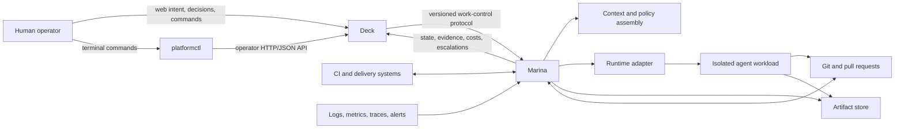
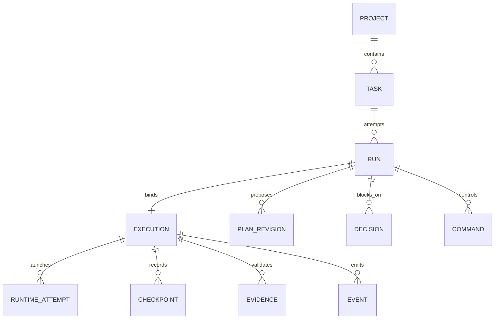
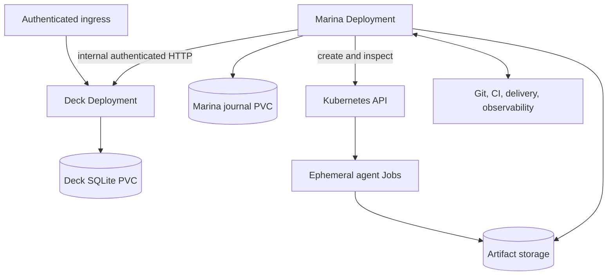

# Deck and Marina Architecture

- Status: Target architecture for the first usable repository workflow
- Scope: `cli/`, `deck/`, and `marina/` in the `the-platform` monorepo
- Last reviewed: 2026-09-17

## Purpose

Deck and Marina are separate products that should evolve together through an explicit, versioned contract.

- **Deck is the operator control room and authoritative human-facing ledger.** It owns work intent, priorities, approval boundaries, decisions, commands, visible run state, and the evidence presented to the operator.
- **Marina is the always-on factory engine.** It claims authorized work, persists execution state, assembles context, applies policy, drives runtimes, verifies outcomes, reconciles failures, and publishes normalized state and evidence.

Neither product should absorb the other. Deck must remain useful with different agent systems, and Marina should preserve the future option of another work-control provider or a headless adapter. Their default combination should nevertheless feel like one dependable system rather than two databases that happen to exchange HTTP requests.

`platformctl` is a separate, stateless operator client. It sends human intent to Deck and renders Deck's authoritative state through supported HTTP/JSON endpoints; it does not call Marina directly or own a third ledger.

This document translates the product visions into component boundaries, data ownership, protocols, lifecycle rules, failure behavior, and delivery stages. It distinguishes the current implementation from the target architecture; it is not a claim that every component described here already exists.

## Architectural thesis

The two products form a control system with two deliberately different kinds of durable state:

1. Deck records **what the operator wants and what the operator is allowed to believe** about the work.
2. Marina records **how the factory is carrying out that work and how it can safely recover**.
3. External systems remain authoritative for their own facts: Git for source revisions, CI for check results, the delivery system for releases, and observability systems for operational signals.

The integration is a reconciliation protocol, not a distributed transaction. Calls can time out after succeeding, events can be delivered more than once, and either service can restart between any two steps. Correctness therefore comes from durable intent, idempotency, version checks, lease fencing, replay, and evidence—not from assuming exactly-once delivery.

## Current repository workflow

An explicit workflow configuration now enables the bounded first-release path:
task snapshot and authority → immutable plan/approval → coding Job → scoped
branch/commit → separate verification Job at the published revision → PR →
required CI and current-head checks → structured evidence and completion.
Failed verification, closed/changed PRs and requested changes produce a blocker.
One implementation and one verification attempt are supported; cancellation
waits for observed Job termination. The configured workflow rejects pause,
resume, replan, retry and reduce-authority commands. Automatic revision loops and
independent semantic review are deferred; separate verification runs deterministic
checks. Completion means a PR ready for human review, with no merge or deployment.

The supported pair is two HTTP/JSON services. Alternative providers, standalone
headless execution and in-process packaging remain future work. The operator CLI
uses Deck's session/CSRF API and is not a headless Marina provider.

The fixed workflow is under `marina/internal/flow/`; its Kubernetes, GitHub/GHES,
worker, model/source gateway and content-addressed artifact implementations remain
inside Marina. Deck owns only ledger facts and an authenticated proxy for
registered artifact downloads. Both products keep separate storage and identity.
The [paired installation](deploy/kubernetes/first-release/README.md) supplies TLS,
worker isolation, RBAC and an acceptance procedure. The selected installation's
model compatibility, CNI isolation and recovery still require a real cluster test.

`make conformance` now verifies the complete controller workflow over real Deck
HTTP with separate persistence, restarting Marina's journal between boundaries.
Git/runtime doubles make this a deterministic protocol and recovery proof; it is
not evidence of a completed external model, Git or Kubernetes acceptance run.

## Accepted agent-platform extension

[Decision 0015](docs/decisions/0015-marina-agent-platform.md) adds a bounded,
unimplemented PoC/MVP after the repository release: the existing Marina service
will share execution controls between the coding workflow and one read-only
analysis workload using another harness. Repository materialization, Git/PR/CI
steps and source-revision checks remain workflow-specific; both workloads retain
explicit authority and admissible evidence. Deck keeps the authoritative task
ledger, and profile selection/invocation uses the supported public contract.
AGENT-01 through AGENT-13 in [TODO.md](TODO.md) track delivery without requiring
a third component or changing the current single-operator deployment topology.

## Earlier foundation snapshot

The following table records the earlier control-only gate. Its gaps motivated
the current workflow above; the rest of this document also describes later targets.

| Area | Implemented at the earlier gate | Gap identified at that gate |
| --- | --- | --- |
| Deck work model | Projects, structured task budgets, versioned/fenced runs, immutable plan revisions, revision-bound decisions, durable commands, structured evidence, channels, provider-neutral operational state, projected events, artifacts, and operator sessions in SQLite | Multi-user permissions and external artifact-byte storage |
| Deck API | Authenticated operator sessions, capability-scoped service protocol discovery, ready work, atomic/versioned claim, claim recovery, assigned-run pagination, guarded lifecycle mutation, immutable planning, structured evidence completion, channels, operational projections, deterministic export/import, stable errors, and SSE | Federated human identity and a future incompatible protocol major only when additive version 1 can no longer preserve semantics |
| Marina work-control adapter | Provider-neutral ports plus a Deck HTTP adapter covering discovery, stable registration, acquisition recovery, immutable plan submission, decision inspection, guarded run control, commands, projections, protocol validation, and rotatable file credentials | Structured-evidence publication required by later completion stages |
| Marina durability | Stable installation identity, versioned project bindings, acquisition intents, guarded executions, budgets, retry state, checkpoints, evidence, runtime attempts and artifacts, context and policy snapshots, validated signals, ordered provider outbox, command cursors, events, and restart planning in SQLite | Delivery records and external artifact-byte storage |
| Marina reconciliation | Bounded work intake, exact claim binding, lease renewal, terminal convergence, budget stopping, ordered commands, cancellation fencing, classified retries, outbox publication, and locally tested plan/decision reconciliation | Enabled runtime, context, verification, source-control, and delivery controllers |
| Always-on deployment | Separate single-replica Kubernetes bases for Deck and Marina with `Recreate` updates and `ReadWriteOnce` SQLite storage; Deck has an optional file-configured operator-session boundary | Paired overlay, secret distribution, encrypted service transport, network policy, artifact storage, backups, and the agent Job runtime |
| End-to-end outcome | Real-process proof of lossless handoff, restart recovery, fencing, budget stop, projection deduplication, and cancellation convergence | A bounded task becoming a merge-ready pull request while the operator is offline |

At that gate, work was claimed only into the durable control ledger. That mode
remains available without workflow configuration; configured installations now
enable the narrower repository workflow described above.

## Scope of the architecture below

The following invariants and component/lifecycle designs include future targets.
The current workflow above defines implemented behavior. In particular, descriptions
of retry, pause/resume, automatic context discovery, semantic review, delivery and production
feedback do not establish those capabilities in the one-pass repository workflow.

## Non-negotiable invariants

1. **One canonical owner per fact.** A field may be projected elsewhere, but two components must never independently author the same fact.
2. **No shared database.** Deck and Marina communicate only through a supported contract. Neither reads or writes the other's SQLite file or migrations.
3. **One work-control provider per project.** A Marina project binding names exactly one authoritative provider to avoid split-brain task and decision state.
4. **At-least-once is normal.** Every externally visible mutation is idempotent and safe to retry after an unknown response.
5. **Every run mutation is fenced.** Agent identity alone is insufficient; active mutations require the current run version and lease fencing token.
6. **Authority expires.** A runtime may not continue mutating source control or environments after cancellation, budget exhaustion, or loss of its fenced lease.
7. **Claimed intent is immutable.** A run is bound to a specific task revision and acceptance-criteria digest. Later task edits require an explicit replan, cancellation, or new run.
8. **Ephemeral compute never owns durable progress.** Plans, checkpoints, commands, artifacts, usage, and evidence survive runtime and controller restarts.
9. **Completion is evidence-gated.** A model assertion or non-empty Markdown report cannot by itself complete a run.
10. **A producer is not its only consequential verifier.** Independent deterministic checks or review are required according to risk.
11. **Human control is durable.** Pause, cancel, replan, retry, and authority changes are recorded commands with acknowledgement, not transient UI gestures.
12. **External content is data.** Issues, comments, logs, retrieved documents, and tool output never become trusted instructions without classification and provenance.
13. **Secrets are references, not payloads.** Credentials never appear in tasks, plans, context manifests, events, artifacts, evidence summaries, or logs.
14. **Recovery is a normal path.** Every lifecycle step defines replay, timeout, cancellation, and partial-success behavior before it is considered implemented.

## System context



The first implementation remains a modular pair of services. Internal controllers should stay in the Marina process until scaling or failure isolation provides measured reasons to separate them.

## Responsibility and source-of-truth boundaries

| Fact or capability | Canonical owner | Projection or consumer |
| --- | --- | --- |
| Project name and human-facing description | Deck | Marina project binding references the provider project ID |
| Repository, default branch, runtime, policy, and adapter configuration | Marina project binding | Deck displays safe summaries and active policy version |
| Project knowledge, custom instructions, and selected context-source registrations | Deck | Marina consumes explicit revisions; Git remains authoritative for repository-owned content |
| Assembled task-context package | Marina | Deck exposes a derived immutable snapshot with source provenance |
| Task outcome, constraints, acceptance criteria, priority, and authorized budget | Deck | Marina snapshots the claimed revision |
| Task readiness and operator-visible status | Deck | Marina reads and reconciles it |
| External run ID, task assignment, lease, and fence token | Deck | Marina persists an exact binding |
| Human-facing plan revisions and approval decisions | Deck | Marina authors proposals and consumes decisions |
| Project conversation and promotion into bounded tasks | Deck | Humans and agents append messages; referenced ledger records remain canonical and unchanged |
| Pause, cancel, replan, retry, and authority commands | Deck | Marina consumes and acknowledges them |
| Execution state, retry counters, checkpoints, usage, and recovery intent | Marina | Deck receives normalized projections |
| Runtime attempts, handles, workspace, and cleanup state | Marina | Deck receives useful summaries, not provider internals |
| Source revision and pull-request state | Git provider | Both products reference immutable IDs and URLs |
| CI, scanner, and deployment observations | The producing external system | Marina validates and packages them as evidence |
| Evidence-policy evaluation | Marina | Deck stores and presents the decision and supporting records |
| Provider-neutral rollout and observation state | Deck ledger | Marina publishes normalized environment, rollout, rollback, policy, and observation facts |
| Artifact bytes | Configured artifact store | Marina writes; Deck stores metadata, digest, and URI |
| Operator audit timeline | Deck | Marina publishes normalized events through a durable outbox |
| Internal recovery/audit timeline | Marina journal | Used for reconciliation and diagnostics, not as a second task ledger |

Deck's timeline and Marina's journal are not competing ledgers: the former explains the work to the operator; the latter proves and recovers the factory's internal actions. Published events carry correlation IDs so the two histories can be traced without being identical.

## Shared domain model

### Identity and cardinality



- A **task** is durable intent and can have several runs over its lifetime.
- A Deck **run** is one operator-visible attempt by a logical factory agent.
- A Marina **execution** has a one-to-one binding to one provider run. It must never silently switch to a replacement run.
- A **runtime attempt** is ephemeral compute within an execution. Bounded infrastructure retries may create several runtime attempts without creating deceptive new Deck runs.
- A material replan, changed task revision, operator retry after a terminal result, or exhausted run budget creates a new provider run and a new Marina execution.

Every record crossing the boundary carries, where applicable:

- provider and project IDs;
- task ID and frozen task version;
- provider run ID and Marina execution ID;
- stable logical agent ID;
- plan revision ID;
- runtime attempt ID;
- source revision;
- correlation and causation IDs;
- schema and policy versions.

IDs are opaque and stable. Display names are never used as identity.

### Project binding

Marina needs a versioned `ProjectBinding` that connects a work-control project to execution infrastructure without pushing provider details into Deck. Its logical contents are:

- work-control provider and external project ID;
- source-control repository and default branch;
- runtime adapter and harness profile;
- context-source configuration;
- artifact-store configuration;
- verification and review policy;
- delivery integration and authority boundary;
- budget ceilings and concurrency limits;
- active configuration and policy versions.

A claimed task may narrow these limits but may never expand them. Project-binding changes do not alter an active execution silently; the execution retains the versions it started with.

### Task snapshot

At claim time, Marina persists an immutable snapshot containing the task ID, task version, outcome, constraints, acceptance criteria, budget, and a digest of those fields. Deck stores the same task revision on the run. If the human edits the task during an active run, Deck records a new task version and issues an explicit replan or cancel command; the running agent does not consume the change accidentally.

### Plans, decisions, and commands

These are different resources:

- A **plan revision** is an immutable proposal with a revision number, verification strategy, risk classification, expected side effects, rollback approach, context digest, and author.
- A **decision request** is a bounded question with options, recommendation, rationale, expiry, and the plan or execution version it applies to.
- A **command** is an operator instruction such as pause, resume, cancel, replan, retry, or reduce authority. It has a monotonic sequence, delivery state, acknowledgement, and result.

Answers never overwrite old plans. A stale answer or command cannot apply to a newer run or plan revision.

### Structured evidence

Evidence is a set of typed records rather than one Markdown completion string. Each record includes:

- stable evidence key and type;
- producer and verifier identity;
- task, execution, plan, policy, and source revision;
- command, check, or observation performed;
- environment and tool version;
- outcome and concise summary;
- immutable artifact URI and digest when output exists;
- observation time, freshness window, and provenance;
- admission result from the relevant evidence policy.

Markdown remains useful as a rendered report, but it is derived from structured evidence and is not the gate itself.

### Channels and portable ledger

Project channels are append-oriented collaboration records. A message can reference canonical task, run, decision, artifact, and evidence IDs, but it cannot edit them, claim a run, or grant ambient authority. Promotion is a separate operator action that creates a versioned task only when acceptance criteria and a structured budget are supplied.

Deck can export its project ledger as deterministic, versioned JSON containing tasks, runs, plan revisions, decisions, commands, events, artifact metadata, evidence, channels, messages, operational state, and the agent references needed by those records. Credentials and artifact bytes are excluded. Import is transactional and requires an empty target project; it is a restore/handoff operation, not a last-write-wins merge protocol.

## Lifecycle model

Deck's task state is the operator-facing roll-up. The provider run and Marina execution carry the attempt state.

| Deck task | Deck run | Marina execution | Meaning |
| --- | --- | --- | --- |
| `ready` | none | acquisition may be pending | Work is eligible but not owned |
| `planning` | `planning` | `planning` | Exact task revision is claimed and a plan is being prepared |
| `waiting_decision` | `waiting_decision` | `waiting_decision` | A version-bound human decision blocks progress |
| `running` | `running` | `running` | One bounded runtime attempt may be active |
| `verifying` | `verifying` | `verifying` | Runtime output exists but completion gates are not yet satisfied |
| `done` | `completed` | `completed` | Evidence was admitted and external completion was acknowledged |
| `blocked` | `blocked` | `blocked` | A focused external decision or non-retryable prerequisite is required |
| `failed` or `ready` | `failed` | `failed` | Attempt ended; policy determines whether the task is terminal or requeued |
| `cancelled` or `ready` | `cancelled` | `cancelled` | Authority was revoked; any retry is a new run |

Runtime attempt state is separate: `pending`, `starting`, `running`, `succeeded`, `failed`, `cancelled`, `timed_out`, and `cleaned`. It must not be inferred only from logs.

Terminal states are monotonic for a run and execution. A retry after a terminal state creates a new run/execution pair. A transient runtime retry within a still-active execution increments the runtime attempt and remains within the original plan and budgets.

## End-to-end control flow

### 1. Discover and acquire work

Polling is the correctness path for the first proof. SSE, webhooks, or a queue may wake Marina sooner, but reconciliation must still recover missed notifications.

1. Marina validates the provider's protocol version and required capabilities before enabling claims.
2. Marina lists ready work for a configured project and applies local concurrency and policy filters.
3. Before calling Deck, Marina persists an **acquisition intent** containing the task ID, expected task version, stable claim idempotency key, logical agent ID, and requested lease.
4. Marina calls the idempotent claim operation.
5. In one Deck transaction, Deck verifies readiness and task version, creates the run, issues a monotonically changing fence token, binds the frozen task revision, records the request result, and appends an event.
6. Marina persists the exact returned run and fence in an execution record before starting any runtime.
7. If the response is lost, Marina repeats the same idempotency key or looks up the claim by key. It never issues a fresh blind claim.
8. On restart, Marina reconciles unresolved acquisition intents and active runs assigned to its stable agent identity.

This closes the current crash window between a Deck claim and creation of Marina's journal record.

### 2. Plan and decide

Marina assembles a preliminary context manifest, produces a plan revision, evaluates risk and policy, and publishes the immutable plan to Deck. If approval is required, Deck creates a decision bound to that exact plan revision. Marina continues heartbeats while waiting, consumes the answered decision idempotently, and starts only if the answer and active policy authorize that revision.

A change request produces a new plan revision. It does not turn the run into a generic blocked terminal state unless the operator explicitly ends the attempt.

### 3. Execute and checkpoint

Marina creates a runtime attempt through the selected adapter using a pinned source revision, immutable context package, resource limits, expiry, and task-scoped credentials. The runtime streams normalized observations, but Marina persists meaningful state and checkpoints before publishing them.

Progress delivery uses a durable outbox. If Deck is unavailable, Marina may retry publication without duplicating timeline entries. High-volume logs stay in artifact or observability storage; Deck receives milestones, state changes, decisions, usage, and evidence summaries.

### 4. Verify and complete

1. Runtime output is collected and its source revision is fixed.
2. Deterministic repository checks, scanners, and policy checks run against that revision.
3. Independent review runs when required by risk policy.
4. Marina persists structured evidence and evaluates the evidence set.
5. Marina records a completion intent and publishes evidence plus the guarded completion request through its outbox.
6. Deck atomically stores the evidence projection and transitions the exact fenced run and task.
7. Only after Deck acknowledges that transition does Marina confirm the execution as externally synchronized and terminal.

A timeout after step 6 is harmless: replaying the same idempotency key returns the original result. Missing, stale, mismatched, or failed evidence leaves the run in verification, triggers a bounded revision attempt, or creates a focused escalation.

### 5. Cancellation now; pause and replan targets

Deck assigns every command a durable sequence. Marina processes commands in order, checkpoints before acting, stops new side effects, invokes the runtime adapter, revokes or lets scoped credentials expire, and records an acknowledgement. Cancellation and authority reduction take precedence over ordinary progress.

Future pause support must be cooperative and bounded: if a runtime cannot safely pause, Marina checkpoints available state and cancels it. Resume creates or resumes a runtime attempt only while the original run, plan, lease, budget, and policy remain valid.

## Work-control protocol

The first transport is versioned HTTP/JSON. Deck publishes the provider-specific OpenAPI contract; Marina keeps provider-neutral ports and a Deck adapter. Neither product module imports the other's internal Go packages.

Service calls use the initial mechanism recorded in [decision 0003](docs/decisions/0003-service-authentication.md): Marina resolves an opaque Bearer credential from a file for every request, while Deck maps only its SHA-256 fingerprint to a stable service identity with explicit project and capability grants. Overlapping fingerprints permit rotation without changing logical-agent or run identity. Missing credentials fail authentication, insufficient grants fail authorization, and an unreadable policy fails closed. TLS or another authenticated encrypted transport is required outside single-host loopback. Human routes use the separate token-exchange and server-side session boundary recorded in [decision 0005](docs/decisions/0005-operator-authentication.md).

The logical contract is split by capability rather than growing one unbounded interface:

| Capability | Required behavior |
| --- | --- |
| Provider information | Health, readiness, protocol version, capabilities, server time |
| Agent registry | Idempotent registration of stable logical identities and capabilities |
| Work discovery | Paginated ready work filtered by project, cursor, and task version |
| Acquisition | Idempotent claim, claim lookup, assigned-active-run recovery |
| Run control | Get exact run; renew lease; guarded state transitions; block, fail, and cancel |
| Planning | Create immutable plan revision and read its bound decision |
| Decisions | Create or read focused decision requests and consume version-bound answers |
| Commands | List commands after a cursor and acknowledge outcome |
| Events | Idempotent batch append of normalized human-facing events |
| Evidence | Publish structured evidence and guarded completion result |

### Capability negotiation and compatibility

Before claiming work, Marina reads a provider-information document containing the protocol version and capability identifiers. Required capabilities fail readiness with a precise diagnostic; optional capabilities disable only the dependent behavior. Additive fields remain backward compatible within a major version. Breaking semantics require a new major protocol version.

Deck should be deployable first with additive capabilities; Marina enables them only after observing support. Each release declares its tested provider-version range.

### Idempotency, concurrency, and fencing

Every mutating request carries:

- a stable idempotency key scoped to provider, project, operation, and logical actor;
- the expected resource version;
- the current fence token for active-run mutations;
- correlation and causation IDs.

Deck stores enough request identity and result metadata to replay a successful response. Reuse of a key with a different payload is a conflict. A stale version or fence is a conflict, not a retryable success. Marina classifies conflict, authorization, policy, rate-limit, transient dependency, and permanent validation failures separately.

The current version-1 implementation persists each successful claim and run mutation atomically with its request digest and serialized result. Keys are scoped to the canonical project, authenticated service identity, and operation; the resource identifier and normalized wire payload are covered by the digest. Exact retries return the original result across process restarts, concurrent retries converge on one transaction, and changed payloads return `409 conflict`. Service mutations require a caller-supplied `Idempotency-Key`; active-run mutations additionally require the logical agent, exact resource version, and current fence token.

A new ownership epoch—initial claim, authorized reacquisition, or explicit fencing after revocation—issues a higher fence token. An ordinary renewal advances the run version and lease expiry while returning the current fence. An old runtime or delayed request from an earlier ownership epoch cannot append progress, submit evidence, or mutate lifecycle state.

### Event envelope

Normalized cross-product events contain:

- globally unique event ID and producer-local sequence;
- event type and schema version;
- producer, project, task, run, execution, and attempt IDs;
- correlation and causation IDs;
- occurrence and ingestion times;
- severity and redacted payload;
- task version, source revision, and policy version where relevant.

The publisher outbox and Deck's event-ID uniqueness make delivery idempotent. Marina never lets a later projection overtake an unpublished or exhausted earlier projection in the same execution stream; command acknowledgements are the explicit priority exception so cancellation can pre-empt ordinary progress. Consumers still use sequence numbers and tolerate gaps while reconciliation catches up.

## Marina internal architecture

Marina begins as a modular monolith containing durable, independently testable controllers:

1. **Project registry** loads versioned project bindings and adapter configuration.
2. **Work intake controller** discovers ready tasks, persists acquisition intents, and performs safe claims.
3. **Execution reconciler** computes the next action from persisted state and current external observations.
4. **Authority controller** renews leases, enforces fences and budgets, and prioritizes cancel or policy reduction.
5. **Plan and decision controller** assembles planning context and reconciles versioned approvals.
6. **Context builder** creates immutable, provenance-rich context packages.
7. **Runtime controller** drives one provider-neutral runtime adapter and records attempts and cleanup.
8. **Verification controller** runs gates, admits evidence, and requests revisions or escalation.
9. **Delivery controller** creates and maintains pull requests and later integrates release workflows.
10. **Outbox publisher** projects durable events, evidence, usage, and terminal results to Deck.

Each controller follows the same pattern:

```text
load durable record → observe external state → decide without side effects
→ persist intent/version → perform one idempotent action → persist observation
```

Only one reconciliation cycle acts on a given execution version at a time. Optimistic versions and adapter idempotency protect against duplicate controller instances even before Marina supports active-active deployment.

## Deck evolution

Deck has evolved from the lifecycle prototype into a versioned work-control ledger without becoming the factory engine. The current implementation includes:

- immutable task snapshots on runs and plan revisions rather than one mutable plan field;
- stable service identities, scoped authentication, and audit attribution;
- claim idempotency, fence tokens, versions, and assigned-run recovery;
- durable operator commands with acknowledgement state;
- structured time, attempt, token, cost, concurrency, and authority budgets;
- structured evidence metadata and artifact references with digests;
- provider capability and compatibility information;
- truthful planning, waiting, running, retrying, verifying, syncing, stale-evidence, blocked, and completed display states;
- deterministic project export/import and migration verification.

Later joint gates still need views that distinguish a Deck run, a Marina execution, and ephemeral runtime attempts without exposing Kubernetes internals, plus independently verified backup and restore for the always-on installation.

It should not add runtime scheduling, Kubernetes Job construction, repository checkout, model prompting, CI interpretation, or Marina's execution journal.

## Runtime adapter

The provider-neutral runtime boundary defines the following operations. Resume requires an adapter capability; the current Kubernetes repository workflow cannot pause/resume a coding session:

- `Start` with an idempotency key and immutable run specification;
- `Inspect` returning observed lifecycle, heartbeat, usage, and output references;
- `Resume` only when the runtime supports a safe checkpoint contract;
- `Cancel` with bounded graceful and forced termination behavior;
- `CollectArtifacts` with content digests and size metadata;
- `Cleanup` that is idempotent and independently retryable.

The runtime specification includes the pinned repository revision, context manifest URI and digest, harness version, tool allowlist, network policy, filesystem policy, resource limits, deadline, budget, identity references, and current authority fence.

### Kubernetes mapping

The first adapter maps one runtime attempt to one Kubernetes Job:

- Marina's controller service account receives only the API permissions needed to manage its Jobs and related configuration.
- The agent Job uses a different service account and never inherits Marina or Deck credentials.
- Source-control and artifact credentials are task-scoped, short-lived, and expire no later than the execution's authority or budget.
- CPU, memory, ephemeral storage, wall time, process, filesystem, and network limits are explicit.
- Repository materialization verifies the requested commit before agent execution.
- Checkpoints, artifacts, and evidence live outside the Job.
- Job names and labels include stable execution and attempt IDs for recovery lookup.
- `activeDeadlineSeconds`, backoff behavior, TTL, cancellation, and orphan cleanup are controlled by Marina rather than Kubernetes defaults.

An external managed runtime implements the same lifecycle semantics without pretending to be a Job or Pod.

## Context architecture

[Decision 0014](docs/decisions/0014-project-repository-and-knowledge.md) defines
the accepted project-context direction: one GitHub repository per project and
persistent custom instructions, goals, selected documents, and approved decision
references managed through Deck. Reuse the existing Deck project ID and Marina
project binding. Repository configuration remains Marina-owned; Deck submits
version-checked association requests and displays Marina's safe confirmation. Git-owned instructions and
documents retain Git as their source of truth. Marina assembles the selected
project knowledge and bounded conversation excerpts for each task. The active
workflow persists the package before planning and supplies it to both workers.
Deck freezes source and repository selections on Ready and on the run's claim;
later edits apply only to newly authorized work. The Sources tab displays the
saved outcome, exact inputs, provenance, trust, and omissions. Explicit revocation
is checked at workflow and worker-gateway boundaries. See the
[CTX validation](docs/validation/ctx-02-08-2026-09-21.md) for evidence and limits.

A context package is immutable and content-addressed. Its manifest records:

- task snapshot; the subsequent plan references this package digest;
- repository URL, commit, and relevant paths;
- architecture decisions and repository instructions;
- exact revisions of project instructions, selected documents, and conversation excerpts;
- project policy and authority versions;
- operational observations, if applicable;
- tools and harness version;
- source, digest, trust class, scope, freshness, and expiry for every input.

The package starts small and permits bounded retrieval through trusted tools. Raw external text is labelled untrusted. Decisions and unresolved state are checkpoints, not conversational memory. A later run can reconstruct what an earlier runtime knew without copying private reasoning.

Selected project-source revisions and conversation references are captured with
authorized work. Routine source edits affect newly authorized work; recovery
uses the recorded inputs rather than an unrecorded latest version. Revocation
and conflicting instructions require explicit handling, and context never
expands task authority. Deck's knowledge records remain authoritative; Marina's
immutable packages preserve what the worker received without becoming another
editable project ledger.

## Evidence and verification architecture

Verification is a policy evaluation over an evidence set tied to one source revision. Evidence classes include build, test, lint, security, review, pull-request, delivery, and operational observation.

The target merge-ready-PR gate (beyond the current PR-review boundary) requires:

- the produced diff and commit identity;
- repository-defined deterministic checks with exit status and command provenance;
- risk-appropriate independent review not performed solely by the producing runtime;
- pull-request identity and current head revision;
- current CI status for that same revision;
- an explicit record that no required gate is missing or stale.

An evidence record can be superseded but not overwritten. Any source change invalidates evidence whose subject digest no longer matches. Deck shows admitted, rejected, stale, and missing evidence distinctly.

## Security and identity

The single-operator boundary reduces product complexity, not security requirements.

- The human authenticates to Deck; Deck distinguishes human actions from service actions.
- Marina uses a stable installation identity and scoped opaque service credential to call Deck; the token is resolved from a file per request and never persisted in its journal.
- Deck keeps only high-entropy token fingerprints in a reloadable policy and authorizes each service operation by explicit project and capability grants.
- Each logical agent identity is durable; each runtime attempt has a separate workload identity.
- Deck authorizes operations by project, run ownership, resource version, and fence—not only by possession of a generic token.
- Marina resolves secret references at the last responsible moment and never persists secret values.
- Runtime egress is denied by default and allowed per harness profile.
- Logs and event payloads pass through size limits and secret-redaction tests.
- Untrusted repository code runs only in the isolated runtime, not inside the Marina or Deck process.
- All consequential actions include actor, authority, policy decision, target, and correlation metadata.

## Deployment topology

The first always-on topology uses two independently deployable single-replica services:



- Only Deck's human interface needs ingress. Marina's HTTP surface remains cluster-internal unless an authenticated operational API is added.
- The services use separate databases, PVCs, service accounts, network policies, backup policies, and migration lifecycles.
- SQLite remains acceptable while each service has one writer and one replica with `Recreate` updates.
- Deck and Marina can share a namespace initially, but not identity or storage.
- Local development runs the same HTTP contract with processes or containers; it must not introduce a code-only integration path.
- Artifact storage may begin on durable local or cluster storage behind a contract. Deck stores references rather than depending on a shared filesystem.

Move a service to PostgreSQL when that service independently needs active-active writers, multi-node failover, multi-operator tenancy, or measured throughput beyond SQLite. One product's migration does not force the other to migrate.

## Failure and recovery behavior

| Failure | Required behavior |
| --- | --- |
| Deck unavailable before claim | Marina claims nothing and reports degraded readiness |
| Deck credential or authorization policy is missing | Marina performs no authorized mutation; Deck returns a correlated authentication, authorization, or retryable service-unavailable error without exposing credential material |
| Credential rotates during reconciliation | The stable service and logical-agent identities remain unchanged; overlapping fingerprints avoid interruption, and any transient denial is handled as a bounded external failure |
| Claim response lost | Replay the same claim key or recover it by key; never create a blind second claim |
| Marina crashes after Deck commits a claim | Startup resolves the durable acquisition intent or assigned active run before doing work |
| Marina journal unavailable | Marina is not ready and performs no external mutations |
| Deck unavailable during an active run | Prioritize lease renewal; checkpoint and stop new side effects before authority can expire; queue safe projections in the outbox |
| Lease or fence becomes stale | Stop or cancel the runtime; reject all stale progress, evidence, and lifecycle writes |
| Marina restarts with an active runtime | Inspect exact runtime handle and provider run before resume, retry, or cleanup |
| Runtime start response lost | Inspect by execution/attempt idempotency key before issuing another start |
| Runtime fails transiently | Retry within the same execution only if plan, lease, source, and budgets remain valid |
| Runtime fails permanently | Persist classification, publish evidence and failure, then block or fail according to policy |
| Operator cancels while work is running | Cancellation wins; stop side effects, cancel runtime, acknowledge command, and converge both ledgers |
| Evidence or artifact storage unavailable | Do not complete; remain verifying, retry within budget, or escalate |
| Deck accepts completion but response is lost | Replay completion idempotently and then confirm Marina's local terminal synchronization |
| Provider is terminal while Marina is active | Provider authority wins for cancellation/failure; Marina stops work and converges without creating replacement work |
| Services disagree after restoration | Reconcile immutable IDs, versions, fences, and evidence; never resolve disagreement by last-write-wins timestamps |

Recovery tests must inject a restart before and after every external call and local commit in acquisition, runtime start, command handling, and completion.

## Observability and operability

Both services emit structured logs and metrics using the shared correlation fields, while retaining separate service identities.

Minimum signals include:

- ready tasks, acquisition intents, claims, conflicts, and claim latency;
- active runs by state, lease time remaining, renewals, stale fences, and orphan candidates;
- controller cycle duration, retry count, classified failures, and reconciliation lag;
- runtime queue, start latency, duration, cancellation, cleanup, and resource usage;
- context and policy versions, package size, and provenance coverage;
- evidence admitted, rejected, stale, and missing by gate;
- outbox depth, oldest unpublished event, Deck synchronization lag, and command acknowledgement lag;
- tokens, cost, human-attention time, and verified outcomes.

Liveness means the process can serve; readiness means its durable store and required dependencies can support safe behavior. A degraded dependency must be named explicitly. Audit and diagnostic exports redact secrets and untrusted oversized payloads.

## Contract and system verification

The product modules remain independently buildable, but their releases need shared evidence:

1. Deck validates its OpenAPI document and tests idempotency, fencing, transitions, and migrations.
2. Marina runs a reusable work-control conformance suite against every adapter.
3. Shared JSON fixtures cover capability negotiation, errors, plans, commands, events, budgets, and evidence.
4. Consumer-contract tests detect when a Deck change would break the Marina adapter.
5. A paired local environment tests real binaries and databases over HTTP.
6. Crash tests cover lost requests and responses at every dual-write boundary.
7. Kubernetes tests cover controller and Job restarts, cancellation, deadline, eviction, and orphan cleanup.
8. Local installation acceptance restarts Deck and Marina at controlled points and still produces one truthful outcome or focused escalation. The Mac remains running because it hosts the test cluster. Laptop-off proof (RUN-10) and deliberately failing or evicting an active worker (RUN-17) were removed from the first-release gate by the operator; broader runtime failure tests remain part of system verification.

Mocks prove local logic; they are not sufficient evidence for the cross-product milestone.

## Delivery stages and gates

### Gate A: lossless work-control handoff

Deck and Marina negotiate capabilities, authenticate, acquire a task idempotently, fence every mutation, recover a lost claim response, publish events once, and converge cancellation without duplicate runs.

Status: complete. The accepted mechanics and verification evidence are recorded in [decision 0004](docs/decisions/0004-milestone-one-work-control-safety.md).

### Gate B: always-on paired control plane

Both services run with separate durable stores, backups, probes, identities, and network policy. Restarting either service preserves exact run ownership and a truthful Deck view.

### Gate C: restart-safe Kubernetes worker

Marina starts, inspects, cancels, and cleans an isolated Job at a pinned revision. Checkpoints and artifacts survive Job replacement, and authority cannot outlive the fenced lease or budget.

### Gate D: unattended PR ready for human review

A frozen task and repository revision, versioned plan/decision, one implementation,
separate deterministic verification, PR/CI observation and structured evidence
complete while the operator is offline, or report a blocker. Installation-specific
acceptance is still required. Automatic CI/review revisions, automatic context discovery,
independent semantic review, and merge authority are later gates, not release claims.

### Gate E: bounded delivery and feedback

Existing delivery and observability systems provide source-bound evidence for a canary, rollback, and one validated operational remediation loop.

The ordered implementation work for these gates is maintained in [TODO.md](TODO.md).

## Architectural defaults

The following defaults are now explicit for the first proof:

- Keep Deck and Marina in one product-boundary monorepo while retaining separate modules and deployable services.
- Keep terminal clients stateless and independently releasable; route their reads and mutations through Deck's public operator API.
- Use Deck's HTTP/JSON API as the first work-control transport.
- Use polling and reconciliation for correctness; treat streaming notifications as latency optimizations.
- Bind one Deck run to one Marina execution and allow bounded runtime attempts underneath it.
- Use separate SQLite databases and single replicas until measured triggers justify independent PostgreSQL migrations.
- Store artifact bytes outside both databases and exchange immutable references and digests.
- Stop at a PR ready for human review; the current workflow has no merge/deploy authority.
- Use scoped opaque credentials as the first Marina-to-Deck service-authentication mechanism while preserving authorization semantics for a later OIDC replacement.
- Add controllers inside the Marina process before considering extra services or a Kubernetes operator.

## Open decisions requiring dedicated records

Before the relevant implementation becomes irreversible, record decisions for:

- the first always-on cluster, storage class, backup mechanism, and namespace topology;
- broader task-history expiry or online collection beyond the [conservative offline artifact retention policy](docs/decisions/0013-conservative-artifact-retention.md);
- additional harnesses and credential models (Codex Jobs and the scoped Git/model gateway are implemented);
- future policy/context integration beyond the current fixed repository rules;
- the first alternate runtime used to prove portability;
- the first production-feedback source and observation window;
- actions that always require a human decision;
- evidence and operating history required to move beyond PR-review authority.

The architecture is successful when either product can evolve internally without corrupting the other's state, while their combined system can lose responses, restart processes, replace agent compute, and still produce one evidence-backed account of one bounded outcome.
