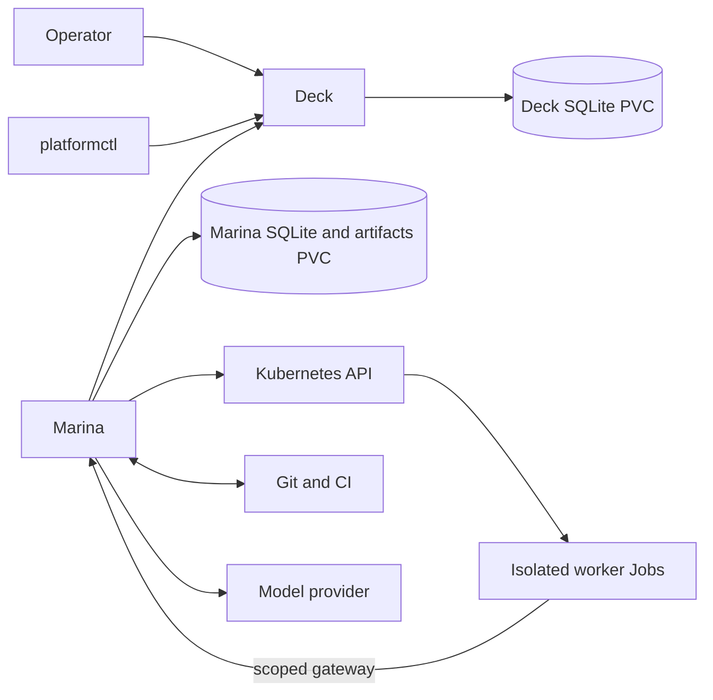

# Deck and Marina architecture

- Status: current architecture and supported release boundary
- Scope: `cli/`, `deck/`, and `marina/`
- Last reviewed: 2026-09-22

## System boundary

Deck and Marina are separate products joined by a versioned HTTP/JSON contract.

- **Deck owns human intent and the operator-visible ledger:** projects, tasks,
  budgets, plans, decisions, commands, status, and evidence metadata.
- **Marina owns execution and recovery:** project bindings, immutable context,
  policy evaluation, runtime attempts, usage, artifacts, verification, and
  reconciliation.
- **platformctl** sends operator intent to Deck and renders Deck state. It owns
  no authoritative state and never calls Marina directly.
- **External systems** remain authoritative for their own facts: Git for source
  revisions, CI for check results, and Kubernetes for observed workload state.

Neither service imports the other's internals or reads the other's database.
Each has its own binary, Go module, SQLite store, identity, image, deployment,
and migration lifecycle.

## Supported behavior

### Repository workflow

With a workflow configuration, Marina runs this fixed path:

```text
authorized task -> immutable context -> plan and optional approval
                -> coding Job -> commit -> clean verification Job
                -> pull request -> required CI -> evidence -> completion
```

The workflow supports one repository, one active task, one implementation
attempt, and one verification attempt. Cancellation revokes gateway authority
and completes only after worker termination is observed. Failed verification,
missing or failed CI, a changed PR head, a closed PR, or requested changes produce
a blocker. Completion means a PR ready for human review; Marina does not merge or
deploy it.

### Diagnostic-analysis workflow

An installed `analysis` profile runs a pinned LangChain worker against a fixed
fixture. It uses the same task authorization, leases, fences, budgets, gateway,
Kubernetes runtime, artifact store, and evidence publication as repository work.
It has no repository authority. Its output is checked by an independent Go
validator and bound to the selected profile, inputs, context, and output digests.

Version 2 of the harness may read one explicitly selected context source through
an attempt-scoped gateway tool. The gateway validates the argument, allowlist,
authority, expiry, and revocation outside the Python process.

Without workflow configuration, Marina remains in control-only compatibility
mode. New-intake controls do not pause already journaled work.

## Sources of truth

| Fact | Owner | Other side's use |
| --- | --- | --- |
| Project name and description | Deck | Marina binds the Deck project ID. |
| Repository, default branch, runtime, credentials, and execution policy | Marina | Deck shows a safe versioned summary. |
| Project-authored knowledge and selected conversation excerpts | Deck | Marina resolves exact approved revisions. |
| Repository-owned instructions and documents | Git | Deck registers references; Marina resolves pinned content. |
| Task outcome, acceptance criteria, priority, and budget | Deck | Marina stores the claimed immutable snapshot. |
| Run, lease, fence, plan, decision, and command | Deck | Marina reconciles exact versions. |
| Execution, attempt, checkpoint, usage, and cleanup state | Marina | Deck receives normalized projections. |
| Assembled context package | Marina | Deck exposes a bounded immutable view. |
| Commit and pull-request state | Git provider | Both products reference immutable IDs and revisions. |
| CI result | CI provider | Marina validates it at the current PR head. |
| Evidence decision and artifact bytes | Marina | Deck stores evidence records and proxies authenticated downloads. |

Deck's event history explains work to the operator. Marina's journal recovers
execution. Correlation IDs connect them; they are not competing ledgers.

## Required invariants

1. One component is authoritative for each fact.
2. Every external mutation is idempotent and safe after an unknown response.
3. Active run mutations require the exact resource version and lease fence.
4. Claimed task intent, profile, repository binding, and context are immutable
   for the run.
5. Authority and budgets can only narrow as work proceeds.
6. Ephemeral workers never own durable progress or credentials.
7. Completion requires current, source-bound evidence.
8. A producing worker is not its only consequential verifier.
9. External text and tool output are data; they cannot grant authority.
10. Secrets are referenced at the last responsible moment and never enter task
    text, context, evidence, artifacts, or diagnostics.
11. Restart, timeout, cancellation, partial success, and cleanup are normal
    lifecycle paths.

## Contract and reconciliation

Deck publishes the provider-specific OpenAPI and canonical fixtures under
`deck/api/`. Marina owns provider-neutral ports and the reusable consumer suite
under `marina/internal/workcontrol/`. Capability discovery prevents a consumer
from using behavior that the provider does not advertise. Additive changes keep
version-1 semantics; breaking changes require a new protocol major.

The services do not attempt a distributed transaction. Marina follows this
pattern for side effects:

```text
load durable state -> observe external state -> decide
-> persist intent and idempotency key -> perform one action
-> persist the observation -> publish through the outbox
```

Lost requests and responses are resolved by replay or lookup using the recorded
key. A stale version or fence is a conflict. Marina never guesses that an
operation failed and creates replacement work.

## Identity, context, and evidence

Deck's operator session and Marina's service identity are separate. Service
credentials are project- and capability-scoped. Each runtime attempt receives a
short-lived gateway credential and no Kubernetes token, Git write credential, or
upstream model credential.

When a task becomes ready, Deck freezes its selected knowledge and conversation
references. Marina combines those references with the pinned repository,
installed policy, profile, and task snapshot into a content-addressed context
package. It records provenance, revision, digest, trust, expiry, and omission
reasons. Later edits affect newly authorized work; explicit revocation stops
further use by active work.

Repository completion requires deterministic verification at the published
revision, the PR identity and current head, all configured CI results for that
head, and digest-bound artifacts. Any source change makes earlier evidence stale.
Analysis completion requires a valid report plus independent validation bound to
the selected input and profile digests.

## Deployment

The supported installation uses two single-replica services and ephemeral Jobs:



Both services use `Recreate` updates and `ReadWriteOnce` storage. Do not scale
either SQLite deployment horizontally. Workers run in a separate namespace with
resource limits, a read-only root filesystem, no service-account token, and
network access limited to Marina and DNS. NetworkPolicy is Pod isolation, not a
VM boundary; nodes and DNS remain trusted.

## Failure behavior

| Failure | Required result |
| --- | --- |
| Deck unavailable before claim | Claim nothing; readiness names the dependency. |
| Claim or completion response lost | Replay the recorded key or look up the original result. |
| Marina restarts | Inspect the recorded run and runtime handle before advancing. |
| Lease/fence expires or is rejected | Stop new side effects and terminate the worker. |
| Model response is uncertain | Retain the full reservation; never invent usage. |
| Verification, CI, or artifact storage fails | Do not complete; block or wait within budget. |
| Operator cancels | Revoke authority, terminate the worker, clean up, then acknowledge. |
| PR head changes | Mark earlier evidence stale and block this one-pass workflow. |
| Deck accepts a write but the response is lost | Replay and converge without duplication. |

Live acceptance and deterministic coverage are indexed in
[docs/README.md](docs/README.md).

## Planned extensions

[Decision 0018](docs/decisions/0018-deck-work-preparation.md) adds Deck-owned
backlog refinement, versioned task breakdowns, dependencies, per-task context
selections, budget allocations and readiness gates. Marina executes bounded
planning assistance and eligible children, resolves selected sources, and owns
the immutable packages actually delivered to agents. The
[work-preparation design](docs/work-preparation.md) defines the handoff and
PREP-01–08 delivery gates. These additions are planned; existing run plans do not
provide a backlog-decomposition workflow.

The accepted target in [decision 0017](docs/decisions/0017-kagent-core-engine.md)
moves agent execution and engine interaction state to kagent while retaining
Marina's governed workflows and Deck integration. The
[implementation and removal plan](docs/kagent-integration-plan.md) tracks the
adapter, proof, cutover and deletion of redundant Marina code. This is planned;
the deployment and ownership descriptions above remain the implemented baseline.

The active backlog is [TODO.md](TODO.md). The next product increments are
task-linked web conversations, persistent unread result state, and bounded repair
loops. Pause/resume, transparent harness-step recovery, independent semantic
review, arbitrary tools, multiple concurrent tasks, HA, merge/deploy authority,
and production remediation remain future choices. Their supporting schemas or
ledger records do not make them supported capabilities.
