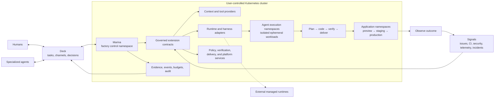

# The Marina Vision

## Starting point and overall goal

The primary problem is dependence on the developer's laptop. In the creator's current workflow, the agent is started locally and receives much of its working context through a conversation on that machine. Coding becomes faster, but execution and continuity still depend on keeping the laptop and session available. Closing the laptop should not interrupt authorized work or make the context needed to continue inaccessible.

The first product promise is to run agents and preserve their work on always-on Kubernetes infrastructure controlled by the operator, on premises or in a chosen cloud. The laptop becomes an access device. Tasks, relevant conversation context, decisions, progress, and results must remain available independently of it, so the operator can disconnect and later reconnect from another device. Deck and Marina should provide this as one coherent experience.

The deployment target is vanilla Kubernetes through standard APIs, without requiring a particular cloud provider or Kubernetes distribution. Installations supply the documented storage, DNS, and network-policy capabilities. The local Podman/Kind cluster is the development test environment; choosing a hosting vendor is not a prerequisite for building or testing the product.

Building on that independence, the overall goal is to let a human delegate a defined software outcome and let agents carry more of the work through autonomously, with less continuous prompting and supervision. The human remains able to discuss, direct, inspect, and intervene. Conversation remains useful for discovering and refining intent; the context required for execution must be durably available to the system.

Remote execution and task autonomy are separate capabilities. Removing the laptop dependency is useful even while humans still initiate work and answer questions. Greater autonomy must then demonstrate lower total human effort on real tasks, including preparation, review, corrections, and system maintenance. The broader software-factory vision below extends this foundation.

## Working through a board, conversation, and inbox

The intended experience lets the operator create work on a board or discuss it in a project web conversation, then delegate it to a configured agent. For example, after discussing a defect, the operator could write `@codex implement the fix we agreed on`. Marina would execute the authorized work on Kubernetes while Deck keeps its task, discussion, progress, and result connected. The operator can leave and return later from another device.

These are complementary views of the same work:

- **Board:** define outcomes, organize priorities, and track progress. A task can be delegated directly without first creating a conversation.
- **Conversation:** explore intent, attach context, ask questions, invoke an agent, and give feedback on a result.
- **Inbox:** find results not yet reviewed and decisions requiring attention, with progress available when wanted. Routine execution should not require watching a live stream.

Context should accumulate at the project level through repository knowledge, documents, prior decisions, and linked work. The system should assemble the relevant parts with the selected conversation for each task, making its interpretation inspectable. Moving between tasks or devices should not require explaining the project again; conflicting or missing intent still needs clarification.

The accepted starting point is one GitHub repository per project, with persistent
custom instructions, project goals, selected documents, and approved decisions
managed through Deck. Marina binds that same project to its repository and
execution settings, then assembles versioned context for each task. Git remains
authoritative for repository-owned knowledge. [Decision 0014](docs/decisions/0014-project-repository-and-knowledge.md)
records this direction; knowledge management and workflow integration remain
future implementation.

An intentional delegation can authorize work within existing project limits without a second form or repeated approval. The system must distinguish a request to explain something from a request to change it, record the agreed outcome and scope, and ask only for missing information or additional authority. A casual mention or quoted instruction is not a delegation. `@codex` illustrates interaction with a configured coding agent; it does not require a hosted Codex execution service or a Slack dependency.

This is the proposed interaction model recorded in [decision 0009](docs/decisions/0009-asynchronous-agent-work.md). Mention-triggered execution and automatic context assembly remain target behavior. The current first-release scope and implemented channel-promotion boundary remain governed by [decision 0007](docs/decisions/0007-sovereign-first-usable-release.md) until delivery priorities are revised explicitly.

## Current delivery focus

Marina runs on Kubernetes infrastructure controlled by its operator, on premises
or in a chosen cloud, independently of the operator's laptop. Ownership,
sovereignty, privacy, and independence from a mandatory hosted control plane are
core product requirements. Model inference, source control, artifacts, and network
egress must have explicit operator-selected data boundaries; Kubernetes hosting
alone is not a guarantee that code stays private.

For the initial pilot, use OpenRouter for inference and GitHub for source control
and image distribution through GHCR. Keep the existing SQLite databases and
artifact files on Kubernetes persistent volumes; backups are deferred for now.
These are installation choices, not permanent product dependencies. The operator's
planned Git service can integrate through a future adapter when its API exists.
[Decision 0010](docs/decisions/0010-initial-installation-services.md) records the
selected services, network scope, and remaining configuration.

This direction is relevant to European sovereignty needs: the [European Commission's technology-sovereignty agenda](https://digital-strategy.ec.europa.eu/en/policies/eu-tech-sovereignty) emphasizes control over technology, data, and infrastructure and reducing external dependencies. Marina's product requirement is to let the operator choose and control execution, stored context, model inference, and external data flows. Hosting agents on a private cluster while sending their code and context to an external model remains an explicit external dependency. Deployment location alone does not establish sovereignty; access, provider and jurisdictional dependencies, and operational control also matter.

The first usable release carries authorized, bounded repository fixes through
isolated execution, separate deterministic verification, and CI observation to a pull request ready
for human review. Deck focuses on authorization, decisions, results, and
exceptions. Additional chat, provider families, and production operations are
deferred. [Decision 0007](docs/decisions/0007-sovereign-first-usable-release.md)
governs this focus over the broader destination described below.

The supported implementation is the Deck–Marina HTTP/JSON pair with separate
stores. It performs one implementation and one verification attempt, supports
cancellation, and blocks on failed checks or requested changes. Headless and
in-process packaging, pause/resume, automatic CI/review revision loops, independent
semantic review, merge and deployment authority remain future work. A PR ready
for human review is not a claim of merge readiness. Full context assembly is also
future integration; the current worker receives the task and pinned repository.

## From coding agent to autonomous software factory

Marina's goal is not to help a developer type code faster. Its goal is to make the software delivery system itself capable of doing useful, governed work continuously—even when no developer has a terminal open, a laptop online, or a hand on the keyboard.

In the session-driven workflow motivating Marina, a human starts an agent, supplies a task, supervises changes, and coordinates the remaining work. The agent can accelerate implementation while the human still has to frame the work, preserve context, interpret failures, coordinate review, react to CI, and decide what happens next. Marina aims to let more of that authorized execution continue independently. This describes the workflow to improve, rather than a limitation shared by every coding-agent product.

Marina is an installable, Kubernetes-native, and extensible software-factory control layer. It turns a Kubernetes cluster into an always-on software engineering system in which durable autonomous agents can take responsibility for bounded outcomes across the SDLC and DevOps lifecycle. Agents plan, implement, test, review, revise pull requests, respond to delivery feedback, observe production signals, propose or perform remediation, and leave behind evidence. Humans move from continuously operating the tools to defining intent, shaping architecture, setting policy, and steering the system where judgment matters most.

Kubernetes is Marina's durable home and execution fabric, not its public product model. Marina should install on a supported cluster, use its scheduling, identity, isolation, reconciliation, policy, and observability capabilities, and expose stable factory concepts above them. Work-control surfaces, agent harnesses, runtime providers, context sources, policy engines, verification systems, delivery systems, and operational signals remain replaceable extensions. An operator should be able to adopt a useful default stack and later replace one boundary without forking the factory core.

The north star is a **dark software factory**: a software delivery system that can continue safe, useful work without a human present on the factory floor. Here, *dark* means **unattended**, never opaque, unaccountable, or uncontrolled.

This product starts from scratch around that north star. Its creator previously built `platform-marina`, an AWS-native AI agent platform around Bedrock and AgentCore, and brings the technical experience from that work. But Marina is a new concept—not a successor, port, rewrite, migration, or cloud-neutral version of the earlier system. Its architecture and product boundaries must be derived from the dark-factory problem itself.

## The problem

The workflow Marina aims to improve couples execution and context to the developer's laptop and local session:

- The agent runs on the laptop and depends on that machine remaining available.
- Relevant context accumulates in local conversations and may require manual reconstruction when changing sessions or devices.
- Progress, decisions, and results may lack a durable home accessible independently of the laptop.
- A person must recognize and describe the next task, then coordinate its progress.
- CI failures, review comments, merge conflicts, deployments, alerts, and production regressions can require human handoffs to bring them into the loop.
- Completion is commonly an agent's claim rather than a state backed by current evidence.
- Progress can stop when the laptop sleeps, credentials expire, context is lost, or the human goes offline.

Optimizing keystrokes or pull-request creation is not the same as optimizing software delivery. The useful unit is not code produced; it is a verified outcome delivered and operated with an acceptable level of risk, cost, and human attention.

## The thesis

The next increase in engineering leverage will not come only from better models. It will come from engineering the system around them:

| Layer | What it engineers | Primary question |
| --- | --- | --- |
| Prompt | One model interaction | What should the model do now? |
| Context | The model's working information | What is the smallest, highest-signal set of facts and constraints it needs? |
| Harness | One bounded agent run | Which tools, workspace, permissions, checkpoints, and exit conditions make the run reliable? |
| Loop | Work across runs and feedback cycles | What triggers the next action, verifies it, persists state, and decides whether to retry, stop, or escalate? |
| Factory | A portfolio of governed loops | How can many outcomes flow safely from intent through production and back again? |

A capable model is a component. An agent adds a decision-and-tool loop. A harness makes that loop operable. Context makes it situated. Loop engineering makes work persistent and repeatable. The factory coordinates many such loops as one observable production system.

Marina is primarily about the last three layers and the contracts between all five.

## Product position: the extensible factory layer

Adjacent products validate important parts of this direction.

[Ona](https://ona.com/docs/ona/understanding/core-components) combines reproducible development environments, agents, runners, guardrails, and event-driven automations. Its [two-plane architecture](https://ona.com/docs/ona/understanding/architecture) supports runners on Ona Cloud or the customer's AWS/GCP infrastructure while Ona hosts the management plane. This makes execution ownership and control-plane dependence separate comparison questions. Marina shares the conviction that background agents need isolated, fully equipped environments rather than a shell attached to a chat session.

[Amp](https://ampcode.com/manual/orbs) gives each unsupervised thread an **Orb**: an isolated remote machine managed by Amp, with the agent's workspace, tools, terminal, and optional services. The same product can also execute on any machine where the [Amp CLI](https://ampcode.com/manual) is running as a **runner**—the operator's laptop, a home server, or another host they already control. Servers inside an Orb are not reachable through the operator's localhost; Amp exposes them through authenticated Portal URLs. Orbs automatically pause after a few minutes of inactivity and wake when a message, terminal session, or portal access resumes the thread; `.agents/resume` can run on wake, and declared services survive pause/resume. Marina shares the conviction that agent compute should be able to leave the laptop without collapsing into a single hosted topology: isolated managed machines and operator-owned runners are both legitimate placements behind one execution contract.

[Herd](https://herd.gehirn.ai/docs/index) describes a persistent meta-harness above Codex, Claude Code, Gemini CLI, OpenCode, and user-controlled machines. It keeps mission state, durable identities, approvals, worker dispatch, and recovery outside any one provider session or transport. Marina shares the conviction that the durable system must live above replaceable agent harnesses.

[Herdr](https://herdr.dev/) is a separate comparison reference from Herd above. Its [open-source runtime](https://github.com/herdrdev/herdr) hosts existing coding-agent CLIs in background terminals, brings local and SSH-connected machines into one view, and identifies agents awaiting attention. Its [persistence documentation](https://herdr.dev/docs/session-state/) distinguishes reconnecting to live processes from restoring layouts and supported agent conversations after a server restart. It is relevant to reducing supervision across personal projects; continued execution requires the machine hosting the work to remain running.

[Kilo](https://kilo.ai/) presents an open-source coding agent across IDE, CLI, and cloud surfaces, with model choice, local-model support, an agent command center, and code-review workflows. It is a useful reference for how Deck and Marina can present one coherent experience across directing, executing, and reviewing work. Its deployment and data boundaries should be evaluated separately against Marina's ownership requirements.

[Devin](https://devin.ai/) positions itself as an AI software engineer for delegated engineering tasks. Its described workflows include planning, implementation, testing, pull requests, and responding to review feedback and CI results, with integrations into existing team tools. For Marina, it is a direct reference for carrying work through to a reviewable outcome and reducing human supervision. Its deployment, authority, and data boundaries require separate comparison against Marina's ownership requirements.

[Background Agents](https://backgroundagents.dev/), documented as [Open-Inspect](https://github.com/ColeMurray/background-agents), is an open-source background coding system with isolated development environments, collaborative sessions, pull-request creation, and scheduled or event-driven work. It targets trusted users within one organization. Its [deployment documentation](https://github.com/ColeMurray/background-agents/blob/main/docs/CONTROL_PLANE_CONTAINER.md) includes a container-hosted control plane alongside Cloudflare, while execution still requires a sandbox provider. It is a close reference for assessing whether adapting an existing system could meet the combined Deck–Marina need; self-hosting alone should not be assumed to distinguish Marina.

[Pizza Bot](https://aws.amazon.com/blogs/opensource/introducing-pizza-bot-an-open-source-inbox-for-ai-agents-that-work-in-the-background/) is a self-hosted, open-source application for background knowledge work. It organizes completed results and requests for human input in an inbox, with durable threads and server-owned execution accessible from different clients. Running that server on an always-on host removes its laptop dependency. It is a community project rather than an AWS managed service, and an interaction reference for Marina rather than an established software-delivery equivalent.

[Codex in Slack](https://learn.chatgpt.com/docs/third-party/slack) provides a concrete conversational handoff reference: a mention with a prompt can start cloud work using thread context and return a result. Marina should study that interaction while keeping execution on its operator-controlled Kubernetes installation.

### Investigation priorities

These products are relevant reference points, but for different layers:

- **Investigate Ona primarily for execution infrastructure.** Study its isolated and reproducible development environments, runner and management-plane separation, Dev Container model, guardrails, secret handling, automations, prebuilds, and warm capacity. These should inform Marina's runtime and environment extension contracts without importing Ona's cloud topology as Marina's architecture.
- **Investigate Amp primarily for execution placement and isolated-machine lifecycle.** Study Orbs versus Amp CLI runners, pause and resume of idle machines, authenticated portals for services running inside the environment, setup and resume hooks, and the boundary between Amp-managed remote machines and any host running the CLI. These should inform Marina's runtime placement options without importing Amp's hosted Orb product as Marina's architecture.
- **Investigate Herd primarily for orchestration and interaction.** Study its persistent state above agent CLIs, commander-worker model, machine routing, approval flow, recovery behavior, and Command Room. These should inform durable agent identity, harness abstraction, specialized-agent dispatch, and Deck's human-agent interaction model without turning Marina into a fleet dashboard.
- **Investigate Herdr primarily for session continuity and operator attention.** Study reconnecting across machines, recognizing blocked agents, and resuming supported sessions. Compare how far these capabilities meet the personal workflow need, and which additional guarantees require Marina's task authority, recovery, and completion evidence.
- **Investigate Kilo primarily for the integrated product experience.** Study how its IDE, CLI, cloud agents, model choice, and review workflows fit together. Compare the effort required to delegate work, follow progress, and assess results with the combined Deck–Marina experience.
- **Investigate Devin primarily for delegated engineering outcomes.** Study task handoff, planning, verification, CI and review iteration, and intervention requests. Compare how much human attention is needed to reach an acceptable result, and how clearly each product communicates evidence and remaining uncertainty.
- **Investigate Background Agents primarily as an existing framework to evaluate for reuse.** Compare its workflow customization, operator effort, ownership boundaries, recovery, and verification guarantees with the combined Deck–Marina target. Treat documented features as claims to validate through use.
- **Investigate Pizza Bot primarily for asynchronous interaction.** Study durable threads, separation of results from required decisions, and returning to work across devices.
- **Investigate Codex in Slack primarily for conversational delegation.** Study using a discussion as task context and returning results to the originating thread.

The framing questions are deliberately different:

- Ona helps answer: **Where and how does an agent work safely?**
- Amp helps answer: **Where can an isolated agent machine live, and how does it pause, resume, and expose services without tying work to a laptop?**
- Herd helps answer: **How are persistent agents coordinated across harnesses and machines?**
- Herdr helps answer: **How much supervision can persistent agent sessions and a clear view of needed interventions remove?**
- Kilo helps answer: **How can coding, remote execution, model choice, and review feel like one coherent product?**
- Devin helps answer: **How much engineering work can be delegated through completion, including ordinary feedback and setbacks?**
- Background Agents helps answer: **Which needs justify building a new system instead of adapting an existing background-agent framework?**
- Pizza Bot helps answer: **How should background work return to the operator when attention is useful?**
- Codex in Slack helps answer: **How can a conversation become an actionable coding task with little handoff effort?**
- Marina must answer: **How does an extensible Kubernetes-native factory govern complete, evidence-backed software outcomes?**

For the first proof, Ona deserves deeper investigation while defining the Kubernetes runtime and environment contract. Amp deserves focused investigation for dual placement—managed isolated machines versus operator-owned CLI runners—and for pause, resume, and in-environment service exposure. Herd deserves focused investigation for Deck interaction, approvals, agent dispatch, recovery, and harness portability. Herdr deserves focused investigation for session continuity and visibility of needed interventions across machines. Kilo deserves focused investigation for the combined delegation and review experience. Devin deserves focused investigation for task completion through CI and review feedback with limited human supervision. Background Agents deserves focused investigation as a potential foundation for a comparable workflow. Marina's intended value in durable reconciliation across intent, execution, evidence, delivery, and production feedback must be tested against these systems' actual capabilities.

Marina's distinct product thesis is to make this durable orchestration layer a Kubernetes-native, extensible software factory:

- **A platform installed on the operator's infrastructure.** The initial product runs as a set of independently governed services and workloads on Kubernetes, not as a laptop session or a required hosted control plane.
- **Outcome orchestration, not only agent or environment orchestration.** Marina owns the durable loop from bounded intent through execution, verification, delivery, observation, and recovery.
- **Factory contracts above infrastructure.** Tasks, runs, authority, context, evidence, artifacts, and policy remain stable even when Pods, Jobs, models, harnesses, clouds, or external providers change.
- **An opinionated default stack with replaceable boundaries.** Deck and the Kubernetes Job runtime provide the first coherent experience; alternative work-control surfaces, runtimes, harnesses, and integrations can be added without redesigning the core.
- **Extensibility without an escape from governance.** Every extension participates in identity, authority, budgets, audit, failure handling, and evidence. Plugins may add capability but may not bypass factory invariants.

Marina is therefore not trying to be another coding model, IDE assistant, cloud development environment, or fleet dashboard. It is the control and reconciliation layer that can compose those capabilities into one inspectable, unattended delivery system.

## The target operating model

The human is not removed from software engineering. The human changes altitude.

The human acts as architect and governor:

- Defines outcomes, priorities, constraints, and acceptance criteria.
- Establishes architecture, engineering principles, and risk policy.
- Chooses where autonomous authority begins and ends.
- Reviews decisions with high ambiguity, novelty, blast radius, or irreversibility.
- Steers the system using evidence from delivery and production.
- Improves the factory when recurring failures reveal a missing capability, constraint, tool, or feedback signal.

The factory performs bounded execution:

- Discovers or receives work.
- Builds a versioned context package.
- Plans and classifies risk.
- Selects an agent runtime and isolated execution environment.
- Implements, tests, reviews, and revises.
- Opens and maintains pull requests.
- Passes through delivery and deployment gates.
- Observes the outcome and reacts within policy.
- Persists state, evidence, cost, decisions, and learning for the next loop.

The first user is the project's creator: one human architect operating personal repositories and steering many agent runs. This single-operator focus is a deliberate product boundary, not an excuse to weaken isolation, authentication, or auditability. Marina should avoid early multi-tenancy, organization administration, team RBAC, and billing complexity while keeping its contracts evolvable for additional users later.

## A real autonomous agent

An independent agent should not be defined as a subprocess spawned inside one terminal conversation. It should be a durable logical actor with:

- A stable identity and declared capabilities.
- Explicit authority and short-lived credentials.
- A goal or claimed task with a renewable lease.
- Durable checkpoints outside the model context window.
- A versioned context package with provenance.
- An isolated, reproducible workspace.
- Time, attempt, token, cost, and concurrency budgets.
- Heartbeats, events, artifacts, and evidence.
- Defined wake-up, pause, resume, cancellation, and escalation behavior.

The agent process itself does not need to run forever. Persistent identity and state should be separated from ephemeral compute. An agent can wake when a webhook, schedule, task, review comment, failed check, alert, or policy event requires work; run in an isolated environment; checkpoint; terminate; and later resume on different infrastructure. The **factory is always on even when individual agents are not**.

This is the key to laptop-off operation. Moving a terminal agent into a long-running container is insufficient. The platform also needs durable scheduling, state, identity, secrets, sandboxing, artifact storage, source-control integration, delivery integration, observability, notification, policy, and recovery after infrastructure failure.

## The autonomous software delivery loop

Marina should eventually close the loop across the whole lifecycle:

1. **Sense** — Receive explicit intent and signals from issues, dependencies, CI, code review, security systems, deployments, support, incidents, logs, metrics, and traces.
2. **Frame** — Convert a signal into a structured outcome with acceptance criteria, constraints, ownership, priority, and budget. Untrusted external content is data, not instruction.
3. **Assemble context** — Select current code, architecture, policy, operational state, history, and tools; record the source and version of each input.
4. **Plan and classify** — Propose a plan, dependencies, verification strategy, rollback path, and risk class. Ask for a human decision only when policy or ambiguity requires it.
5. **Execute** — Claim the work and create an isolated workspace. Use the selected harness and runtime to implement the smallest coherent change.
6. **Verify** — Run deterministic tests and policy checks, then independent agent review where judgment is useful. A producing agent cannot approve its own evidence.
7. **Deliver** — Create or revise a pull request, respond to review and CI, resolve conflicts, and merge only when the applicable evidence gates are satisfied.
8. **Release** — Use the existing delivery system for preview, canary, progressive rollout, rollback, and production promotion according to risk policy.
9. **Observe** — Compare actual behavior with the intended outcome, SLOs, acceptance signals, and guardrails over an explicit observation window.
10. **Respond and learn** — Roll back, remediate, retry, replan, or escalate. Promote only validated lessons into durable guidance; do not turn raw logs or one failed run into trusted memory.

The loop is not "keep prompting until the agent says done." It is a state machine whose transitions require admissible evidence and whose retry paths have budgets and stop conditions.

## Context is factory infrastructure

Long-running autonomy will fail if context is treated as a large prompt assembled once. Marina should treat context as a versioned, queryable supply chain.

The system should distinguish:

- **Intent and policy** — desired outcomes, non-negotiable constraints, risk rules, and architecture decisions.
- **Repository truth** — code, tests, schemas, documentation, build commands, ownership, and executable conventions.
- **Operational truth** — deployed versions, configuration, SLOs, alerts, logs, metrics, traces, incidents, and feature state.
- **Execution state** — task, plan, checkpoints, decisions, tool results, artifacts, and outstanding questions.
- **Experience** — prior outcomes and human feedback, retained with source, confidence, scope, and expiry.

Context assembly should be progressive: begin with a small stable map, retrieve detail when needed, compact stale interaction history, and preserve decisions and unresolved state outside the context window. Every context package should be reproducible enough to answer: *what did this agent know, from which sources, at which versions, when it acted?*

Production data, issue text, pull-request comments, retrieved documents, and tool output may contain prompt injection or incorrect conclusions. Context therefore needs trust labels and provenance, not just relevance scores.

## Harnesses are replaceable execution engines

Marina should not attempt to build a better foundation model or force every agent into one internal reasoning framework. It should define a stable runtime contract around replaceable harnesses.

A runtime adapter should be able to:

- Start, resume, pause, cancel, and time out a run.
- Materialize a pinned repository workspace and context package.
- Expose an allowlisted tool and network surface.
- Issue scoped credentials tied to agent identity and task authority.
- Stream normalized events and heartbeats.
- Checkpoint state and return artifacts, diffs, usage, and verification evidence.
- Report failure in a way another run or another harness can continue.

Codex, Claude Code, a custom agent, an AgentCore harness, or a future runtime should be selectable behind that contract. Portability belongs at the protocol and evidence boundaries; Marina should not standardize the private cognition of each agent.

## Deck and Marina

Deck and Marina should form one product experience for now, with distinct module responsibilities. Independent product experiences remain a future option.

**Deck is the operator's work, conversation, decision, and results surface.** The target combines a board, project conversations, and an inbox around the same durable work. Its first usable experience prioritizes work needing a decision, results ready for review, and exceptions requiring intervention. Existing project channels remain available as supporting context; conversational dispatch and broader chat or project-management expansion remain future work.

Channels are not a second, disposable chat product. They are a conversational entrance into the same durable work graph:

- Humans and agents participate with explicit identities and visible authority.
- A conversation can propose a task, split work, request a decision, attach evidence, or summon a specialized agent.
- Turning conversation into execution creates a reviewable task with an outcome, constraints, acceptance criteria, budget, and authority boundary.
- Messages can reference tasks, plans, runs, deployments, incidents, artifacts, and evidence without copying their canonical state into chat.
- Agent progress and focused escalations return to the relevant channel while Deck keeps the structured ledger truthful.

Natural conversation supplies intent and context. In the proposed interaction model, an explicit delegation in a thread should create or reference the same authorized task used by the board, recording scope and constraints without forcing the operator to re-enter them. Execution uses that durable authorization; ordinary discussion and later messages do not silently expand it. The existing implementation requires explicit operator promotion of channel content into a task.

**Marina is the always-on factory engine and integration host.** It discovers work, reconciles desired outcomes with current state, assembles context, selects runtimes, drives SDLC loops, applies policy, and publishes normalized state and evidence through a stable work-control interface.

Marina should dispatch specialized agents when different skills, context, tools, permissions, or independent verification justify specialization. Their identities and histories are durable, but their compute is normally ephemeral. A planner, implementer, verifier, release agent, or incident agent is a policy-bound capability profile—not necessarily a permanently running Pod or a theatrical job title.

Deck implements that interface as the supported HTTP/JSON service. Provider-neutral ports preserve the future option of another provider or headless adapter, but those are not shipped execution modes. In-process packaging is also future work. The current operator CLI talks to Deck; it is not a headless Marina provider.

Marina should not duplicate Deck's product model, and Deck should not become a general agent runtime. Each project must configure one authoritative work-control provider to prevent split-brain state. When Deck is installed, it owns the human-facing task, decision, and evidence ledger; Marina owns internal workflow checkpoints and reconciles them with Deck after restarts and partial failures.

For laptop-off operation, the chosen work-control plugin cannot exist only as a process on the developer's machine. Deck should retain its local-first development mode while also supporting a durable, always-on deployment as a Marina component.

## Starting from scratch, informed by experience

Before starting Marina, its creator built `platform-marina`, an AWS-native AI agent platform using Amazon Bedrock, AgentCore, Step Functions, Lambda, DynamoDB, S3, and CloudWatch. That work created practical experience with orchestration, sandboxing, identity, policy, quality gates, context and memory, GitHub delivery, observability, traceability, and cost attribution.

That experience belongs to the human architect, not to Marina's inherited design. Marina does not automatically inherit the earlier repository's code, architecture, six-layer model, backlog, requirements, cloud services, agent framework, or design decisions. It begins with a different concept: an autonomous dark software factory built from first principles on Kubernetes.

The earlier work makes important problem areas visible:

1. Agent orchestration.
2. Secure sandbox.
3. Governance and compliance.
4. Quality gates.
5. Knowledge and context.
6. Observability and analytics.

These are experience-backed questions to reconsider, not a mandatory layer model. Every concept and component must earn its place against Marina's new goals. AgentCore, for example, may later prove useful as a runtime adapter—or may not be part of Marina at all.

The governing principle is: **carry forward understanding, not assumptions**. Prior knowledge should improve the questions, trade-offs, and technical judgment applied to Marina without predetermining the answers.

## Kubernetes: the platform's home, not its public API

Kubernetes is the installation target and native operating substrate for Marina's first product, not merely one runtime option. Its model is already a set of durable reconciliation loops: observe current state, compare it with desired state, act, and report status. It provides scheduling, isolation primitives, declarative configuration, secrets integration, workload identity options, resource limits, health checks, restart behavior, and an ecosystem of policy and observability tools. It can run while every developer laptop is off.

However, Kubernetes alone is not an autonomous software factory. It does not define intent, agent identity, task leases, context provenance, verification evidence, pull-request semantics, deployment risk, or when a production signal is safe to act upon.

Marina should therefore be **Kubernetes-native but not Kubernetes-shaped**:

- Install the control plane, default work-control integration, and supporting services through a repeatable cluster distribution with explicit compatibility, upgrade, backup, restore, and uninstall behavior.
- Use Deployments or equivalent long-running workloads for durable controllers and Kubernetes Jobs for the first isolated agent runtime.
- Give controllers, extensions, and agent workloads distinct service identities, storage, permissions, network policy, and failure domains.
- Run the durable factory services on Kubernetes where appropriate.
- Keep the public task, run, event, artifact, evidence, and runtime contracts independent of Kubernetes resource details.
- Begin with ordinary services and jobs; introduce custom resources and operators only when reconciliation requirements are proven.
- Maintain a local container/process adapter for development.
- Allow external managed runtimes or environment providers to execute bounded work through adapters without pretending they are Kubernetes Pods.

This makes the cluster a dependable home for the platform while avoiding a lowest-common-denominator abstraction. Kubernetes owns generic workload orchestration; Marina adds the software-factory semantics Kubernetes does not know.

### Namespace and authority boundaries

The initial topology should make three kinds of workload visibly separate:

| Boundary | Contains | Governing rule |
| --- | --- | --- |
| Platform control namespaces | Deck, Marina, reconciliation, policy, context, evidence, and supporting data services | Durable control services own coordination state but do not run untrusted repository code. |
| Agent execution namespaces | Ephemeral workloads for specialized agents, isolated workspaces, verification, and build activity | Each attempt receives scoped identity, network access, resources, credentials, deadline, and authority. |
| Application namespaces | Preview, development, staging, and production applications created or changed through the factory | Delivery follows environment policy, evidence gates, existing CD controls, observation windows, and rollback rules. |

Namespace separation is the first practical isolation and ownership boundary, not a claim that a namespace is sufficient for every threat model. Higher-risk environments may require dedicated nodes, runtime classes, virtual clusters, or separate clusters. Agent workloads must not share application identities or receive broad cluster credentials. Marina or a delivery adapter performs allowed deployment actions under explicit policy, and application workloads remain independently operable when no agent is running.

## Extensibility is a product requirement

Extensibility is not a future marketplace feature. It is how Marina avoids coupling the factory to one model, harness, cloud, repository host, delivery stack, or user interface.

The core should define explicit extension families:

| Extension boundary | What an implementation supplies |
| --- | --- |
| Work and interaction | Tasks, channels, plans, decisions, commands, operator-visible state, and evidence presentation; Deck is the default |
| Runtime and environment | Start, inspect, resume, cancel, collect, and clean up isolated execution; Kubernetes Jobs are first |
| Harness and model | The bounded agent loop, tools, checkpoints, usage, and normalized output |
| Context and tools | Versioned retrieval, provenance, trust, freshness, and task-scoped capabilities |
| Signals and integrations | Issues, schedules, webhooks, CI, review, security, telemetry, incidents, and notifications |
| Policy and verification | Authority decisions, budgets, deterministic gates, independent review, and evidence admission |
| Source, artifact, and delivery | Repository mutation, immutable artifact storage, pull requests, releases, rollout, rollback, and observation |
| Platform services | Identity, secret delivery, storage, networking, and observability integrations |

Every extension contract should define version and capability negotiation, lifecycle and health, idempotency, timeouts, cancellation, failure classification, identity and authority, configuration and secret references, normalized events, and admissible evidence. A conformance suite should test those semantics against real implementations, not only mocks.

"Plugin" names a logical product boundary, not a commitment to unsafe in-process dynamic loading or a language-specific ABI. An implementation may begin as a compiled adapter and later run as a separately deployed service, sidecar, controller, or remote provider. Packaging may evolve; the versioned contract and factory invariants must remain stable.

The default installation should be useful without assembling a framework from parts. It should ship a coherent Deck, Marina, Kubernetes Job runtime, and baseline integrations while keeping each provider boundary visible and replaceable. The extensibility test is simple: a capable third party should be able to add an implementation at a supported boundary without forking Marina or gaining a path around policy and evidence gates.

## Autonomy is a policy, not a switch

The factory should increase autonomy by risk class and accumulated evidence, not by declaring itself fully autonomous.

| Risk class | Example | Default authority |
| --- | --- | --- |
| Observe | Triage an alert, analyze logs, summarize a failing check | Run autonomously; no mutation |
| Propose | Documentation, tests, dependency update, small code fix | Create branch and pull request autonomously |
| Integrate | Merge a well-bounded low-risk change | Allowed only with independent evidence and explicit repository policy |
| Release | Deploy to preview or non-production | Automated behind delivery gates and rollback capability |
| Operate | Canary, production rollback, tightly bounded remediation | Explicit service policy, blast-radius limits, live health evidence, and escalation |
| Irreversible | Data deletion, broad migration, security-boundary or high-blast-radius change | Human approval required |

The exact thresholds are configurable, but the platform must always know which identity authorized an action, which policy permitted it, which evidence supported it, and how to stop or reverse it.

The first-release authority boundary is a PR ready for human review, with no merge or deployment. Later workflows should keep authority explicit and versioned; evidence from real runs can then justify expanding selected repositories or change classes to merge, release, or bounded operational authority without redesigning the platform.

### Factory invariants

- No lifecycle transition based only on an agent's assertion.
- No action without identity, scope, and an audit event.
- No unbounded loop: every run has time, attempts, spend, and escalation limits.
- No producer is its sole reviewer for a consequential change.
- No raw external signal becomes an instruction or durable memory without validation.
- No silent production mutation; delivery state and rollback path remain observable.
- No learning without provenance, confidence, scope, and a way to revoke it.
- No autonomy level that cannot be paused or reduced by a human.

## Challenge to the vision

The strongest version of this idea must resist several attractive mistakes.

### Writing code does not establish reliable task completion

The ability to produce a plausible implementation does not establish that an agent understood the intended outcome, handled ordinary setbacks, or verified the right behavior. Increasing autonomy is useful when it reduces total human effort at an acceptable level of quality, cost, and risk. Marina must test that hypothesis on bounded work and expand responsibility as evidence supports it. Human clarification and judgment remain part of the workflow.

### A software system is not an assembly line

Manufacturing has repeatable inputs and physical tolerances. Software work often begins with ambiguous intent and changes the environment that evaluates it. The factory metaphor is useful for continuous operation and process control, but dangerous if it implies that all engineering judgment can be standardized. Marina should automate execution and feedback without pretending ambiguity has disappeared.

### More agents do not imply more autonomy

Giving every traditional job title to a separate agent can create coordination cost, duplicated context, correlated errors, and the appearance of review without independent evidence. Start with the fewest loops and roles needed. Add specialization only where different context, tools, permissions, or independent evaluation materially improve the outcome.

### Production feedback is not self-explanatory

An alert can be noisy, a metric can be gamed, a customer report can be wrong, and logs can contain hostile input. A closed loop can amplify a bad diagnosis faster than a human-operated process. Production-driven remediation must use correlation, confidence, risk classification, observation windows, canaries, rollbacks, and explicit stop conditions.

### Extensibility can become abstraction theatre

Clouds, clusters, agent runtimes, and delivery systems differ in identity, isolation, networking, storage, lifecycle, and observability. Abstracting everything immediately will produce a weak lowest-common-denominator platform. Marina should standardize the contracts that matter—work, context, runtime control, events, evidence, and policy—only after proving their semantics with the Kubernetes-native implementation, then validate each boundary with a genuinely different adapter.

### Kubernetes sophistication can become premature infrastructure

A Kubernetes-native product can still overbuild its cluster machinery before the factory semantics are proven. The first milestone should demonstrate durable remote execution with restart recovery and evidence using ordinary services and Jobs; it should not require custom resources, an operator, multi-cluster scheduling, or a service mesh. Add deeper Kubernetes machinery only when measured scheduling, isolation, reconciliation, or tenancy needs justify it.

### Faster output can create faster entropy

Pull-request count, commits, and lines of code are dangerous success metrics. Agents can multiply inconsistency, dependencies, stale documentation, and operational load. The factory must also perform deletion, simplification, documentation gardening, dependency hygiene, architecture conformance, and other forms of entropy control.

### Human attention can remain the bottleneck

If every plan, diff, retry, and deployment waits for review, the laptop is no longer the bottleneck but the human inbox is. Approval boundaries must be risk-based, decisions must be concise and evidence-rich, and repeated approvals should be converted into enforceable policy where safe.

## Measures of success

Marina should optimize verified outcomes and scarce human attention, not code volume.

Useful measures include:

- Lead time from accepted intent or detected defect to verified outcome.
- Total human attention minutes per successfully delivered change, including task preparation, supervision, review, rework, and an allowance for platform maintenance.
- Percentage of tasks completed without synchronous human intervention.
- Percentage of escalations that were necessary and actionable.
- First-pass and eventual evidence-gate pass rates.
- Change failure rate, rollback rate, escaped defects, and mean time to recovery.
- Time from production signal to diagnosis, safe remediation, and confirmed recovery.
- Cost per verified outcome, including model, compute, retries, and review.
- Context freshness and provenance coverage.
- Rate of architectural, security, and documentation entropy.

Autonomy is successful only when it improves these measures without hiding risk or moving toil into a different queue.

## The first proof

The first release must prove this complete repository workflow before attempting
a general platform. Current acceptance uses the local Podman/Kind cluster with
the Mac running and Deck accessed through localhost. The operator removed the
laptop-off gate and second-device requirement for this installation; see
[decision 0007](docs/decisions/0007-sovereign-first-usable-release.md).

1. A human defines a bounded task and acceptance criteria through the installed Deck plugin.
2. Marina claims the task with a lease and persists a plan.
3. Marina starts an isolated Kubernetes job through a runtime adapter.
4. The worker receives the frozen task and pinned repository and implements the change. Full project-context assembly remains future integration.
5. A separate clean verification Job runs deterministic checks and produces source-bound evidence. Independent semantic review is deferred.
6. Marina opens a pull request and observes required CI and its current head. Failed checks or requested changes block; automatic revision loops are later work.
7. The Deck plugin shows truthful state, decisions, cost, artifacts, and evidence after either component restarts.
8. The run stops at a PR ready for human review or a focused blocker. The human retains merge and deployment authority.

The next proof closes a small operational loop: a controlled production-like signal creates a diagnostic task, an agent reproduces the issue, proposes a tested remediation, delivery deploys it to a canary environment, and Marina verifies recovery or rolls back. Direct autonomous production mutation is not required to prove the architecture.

## Evolution path

Stages beyond the bounded first release are targets, including the revision and delivery loops below.

1. **Installable control plane and durable remote worker** — A repeatable Kubernetes distribution, one runtime adapter, isolated workspaces, restart recovery, budgets, normalized events, a work-control plugin interface, and the Deck plugin.
2. **Unattended pull-request loop** — Plan, implement, test, independent review, PR creation, CI/review revision, and evidence-gated completion.
3. **Agent-native collaboration plane** — Deck channels connect natural human-agent conversation to structured tasks, decisions, runs, evidence, and specialized-agent dispatch.
4. **Application delivery loop** — Agent-produced applications run in separately governed preview and non-production namespaces with progressive delivery, observation windows, and automatic rollback.
5. **Production feedback loop** — Alert and telemetry intake, diagnosis, remediation proposals, bounded operational actions, and verified recovery.
6. **Extensible factory ecosystem** — Additional harness and provider adapters, conformance-tested extension contracts, multi-project policy, stronger tenancy, capacity management, and evidence-driven autonomy tuning.

## Non-goals

Marina is not intended to:

- Eliminate human accountability for software and production systems.
- Replace source control, CI, CD, incident management, or observability products.
- Let agents bypass repository protection or delivery controls.
- Treat every task as suitable for autonomous execution.
- Equate an LLM review with deterministic correctness.
- Require long-lived agent processes when durable state and ephemeral execution are safer.
- Require Deck for headless execution or hard-code its storage model into Marina.
- Expose Pods, Jobs, CRDs, or cluster topology as the public factory model.
- Require a fork of Marina to add a supported runtime, harness, context source, work-control provider, or delivery integration.
- Let an extension bypass identity, authority, policy, budgets, audit, or evidence gates.
- Hide one implementation behind superficial "extensible" language without proving a second adapter at the same boundary.
- Optimize for the maximum number of agents, tokens, commits, or pull requests.

## Decisions and current defaults

Five product directions are now explicit:

- Marina is an installable, Kubernetes-native software-factory layer.
- Extensibility across explicit, governed contracts is a core product requirement.
- Marina is initially a single-operator product for its creator's own repositories.
- Deck is the default agent-native work and conversation plane, combining structured task tracking with human-agent channels.
- Deck remains pluggable rather than becoming a mandatory dependency of the factory core.

The remaining product decisions should stay explicit rather than becoming accidental implementation choices:

1. How and where will the first always-on installation run?
2. Which first runtime proves portability after a generic Kubernetes-hosted harness: Bedrock AgentCore, a hosted Codex-style runtime, or another container harness?
3. Which production feedback source should close the first real loop: CI/review feedback, deployment health, an alerting system, error tracking, or support/customer feedback?
4. Which actions must always remain human decisions regardless of confidence or accumulated evidence?
5. What evidence and operating history must exist before a repository advances beyond PR-review authority?

Until these are decided, the recommended baseline is single-operator, installed in a user-controlled Kubernetes cluster, PR-review autonomy as the first-release policy, Deck as the first work-control plugin, a Kubernetes Job as the first runtime, and no assumed alternate provider until the corresponding core contract has been proven.

## Influences

- [Harness engineering: leveraging Codex in an agent-first world](https://openai.com/index/harness-engineering/) — environments, agent legibility, repository knowledge, feedback loops, and human attention as the scarce resource.
- [Unrolling the Codex agent loop](https://openai.com/index/unrolling-the-codex-agent-loop/) — the boundary between a model, the agent loop, tools, context, and a harness.
- [Effective context engineering for AI agents](https://www.anthropic.com/engineering/effective-context-engineering-for-ai-agents) — high-signal context, compaction, persistent notes, and context isolation.
- [Kubernetes controllers](https://kubernetes.io/docs/concepts/architecture/controller/) — desired-state reconciliation as a durable control-loop model.
- [AgentCore harness vs. Runtime](https://docs.aws.amazon.com/bedrock-agentcore/latest/devguide/harness-vs-runtime.html) — a useful separation between managed execution infrastructure and the agent loop itself.
- [Ona core components](https://ona.com/docs/ona/understanding/core-components) and [architecture](https://ona.com/docs/ona/understanding/architecture) — isolated development environments, background agents, runners, guardrails, automations, and separation of coordination from execution.
- [Amp Orbs](https://ampcode.com/manual/orbs) and [Amp manual](https://ampcode.com/manual) — isolated remote machines versus CLI runners on any host, pause and resume of idle compute, and authenticated portals into services running inside the execution environment.
- [Herd documentation](https://herd.gehirn.ai/docs/index) — a persistent meta-harness above replaceable agent harnesses and machines, with durable mission state, approvals, dispatch, and recovery.
- [Herdr](https://herdr.dev/) and [session persistence](https://herdr.dev/docs/session-state/) — background agent terminals, access across machines, intervention visibility, and supported conversation restore; tracked separately from Herd.
- [Kilo](https://kilo.ai/) — an open-source coding agent spanning IDE, CLI, cloud agents, model choice, and review workflows; a reference for the combined product experience.
- [Devin](https://devin.ai/) — delegated engineering tasks, planning, implementation, testing, pull requests, and CI/review iteration; a reference for outcomes and human supervision.
- [Background Agents](https://backgroundagents.dev/) and [Open-Inspect source](https://github.com/ColeMurray/background-agents) — background coding, collaborative sessions, automations, and deployment ownership; a reference for evaluating reuse and distinct product value.
- [Pizza Bot introduction](https://aws.amazon.com/blogs/opensource/introducing-pizza-bot-an-open-source-inbox-for-ai-agents-that-work-in-the-background/) — an inbox for background results and decisions, durable threads, and server-owned execution.
- [Codex in Slack](https://learn.chatgpt.com/docs/third-party/slack) — conversational delegation using thread context and results returned to the discussion.

## The destination

Marina succeeds when software engineering no longer begins with "open the laptop and start the agent."

A human should be able to install the factory on Kubernetes, connect the extensions their environment requires, and collaborate with agents through tasks and natural channels. Conversation should become bounded, reviewable work; specialized agents should execute it in isolated namespaces; and the resulting applications should run in separately governed namespaces. The factory should continue to discover, execute, verify, deliver, observe, and improve within those boundaries while the human steps away. When the human returns, Deck should show not activity theater but an evidence-backed account of what changed, why it changed, what the agents learned, what the system could not decide, and where human judgment has the highest leverage.

That is the shift from faster code writing to an autonomous software delivery system—from a coding assistant to an inspectable dark software factory.
