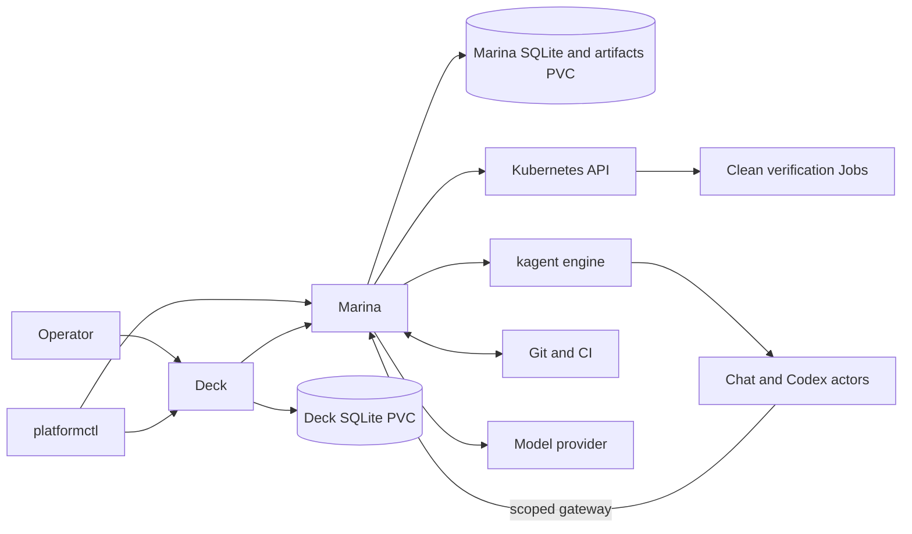

# Architecture

How The Platform is built: the components, how the two loops map onto them, the
tech stack and the rules that keep work safe. Why it exists is in
[VISION.md](VISION.md); what is supported today is in [status.md](status.md).
Planned changes are in [plans/](plans/) until they ship.

Last reviewed: 2026-10-17.

## Components

```text
 browser ──> Deck (steering) ──┐
 platformctl (CLI) ────────────┤  marina.dev/v1          Marina ──> kagent (chat agent, native Codex)
 kubectl, factories ───────────┴──────────────────────>  (API,   ──> Kubernetes (clean verification Jobs)
                                  HTTP/JSON or           runs,   ──> model provider (via Marina's gateway)
                                  Kubernetes resources   recovery) ──> Git and CI
```

| Component | Role | Owns |
| --- | --- | --- |
| **Deck** (`deck/`) | Where I steer. Web UI with projects, what is happening, and the chat. A client of Marina: creates Runs for Ready tasks and Turns for chat, and mirrors their state. | Projects, conversations, tasks, budgets, dependencies, PRDs and acceptance. Never schedules Pods, clones repositories or calls models. |
| **Marina** (`marina/`) | The platform. Serves the `marina.dev/v1` API and runs each Run and Turn to a result or a blocker. | The API, run ledger (runs, plans, decisions, evidence, events), repository binding, credentials, execution policy, immutable context packages, runtime attempts, usage, artifacts, verification, and recovery after restarts. |
| **platformctl** (`cli/`) | Terminal client for Deck's operator API and Marina's platform API. | Nothing; it is stateless. |
| **kagent** (agent engine) | Runs the chat agent and native Codex for repository work, pinned `v1.0.0-alpha1` ([decision 0017](decisions/0017-kagent-core-engine.md)). Marina creates each attempt's own template and gateway Secret ([decision 0024](decisions/0024-per-attempt-engine-templates.md)). | Engine task history and runtime lifecycle. |
| **Git, CI, Kubernetes** | External systems. | Their own facts: source revisions, check results, workload state. |

Deck and Marina are separate products: separate Go modules, binaries, SQLite
databases, identities, images, deployments and migrations. Neither imports the
other's code or reads the other's database. They meet only through Marina's
versioned platform API; Marina calls no client.

## Target: the platform

Marina is becoming the agent and application platform, with the software
factory as one workload on it
([decision 0032](decisions/0032-agent-and-application-platform.md)). None of
this is built yet; the tasks are in the
[platform components plan](plans/platform-components.md).

```text
 workloads     software factory (Deck + repository workflow) │ apps │ other agents
 ───────────────────────────────────────────────────────────────────────────────
 governance    Marina: leases, fences, budgets, frozen inputs, evidence, recovery
 ───────────────────────────────────────────────────────────────────────────────
 slots         runtime │ sandbox │ AI gateway │ ingress │ MCP tools │ telemetry
               evaluation │ secrets │ policy │ authorization │ app runtime
 ───────────────────────────────────────────────────────────────────────────────
 config        Git -> Argo CD -> Kustomize and Helm
 ───────────────────────────────────────────────────────────────────────────────
 substrate     Kubernetes (local Kind, GKE)
```

- Slots are filled by open-source components, CNCF first. Components meet at
  open protocols: A2A, MCP, OpenAI-compatible model APIs, OTLP and Gateway API.
- Marina stays in the request path for model and tool calls, so every component
  is still bound by the live lease, fence and budget.
- One versioned manifest names the component in each slot; Marina freezes it per
  attempt like a profile. Custom resources are added only where they add value.
- Marina owns the platform API and execution state; Deck, `platformctl` and
  `kubectl` are clients ([decision 0033](decisions/0033-marina-platform-api.md),
  [plan](plans/marina-platform-api.md)). Marina installs from its own
  [Helm chart](../marina/deploy/helm/marina/README.md); see [status](status.md).
- First components on local Kind: Kyverno (policy), kgateway (ingress),
  agentgateway (models and MCP), OpenTelemetry Collector and Jaeger (traces).
  What is accepted is in [status](status.md).

## How the loops map to components

| Part of the vision | Today | Target ([decision 0022](decisions/0022-autonomous-software-factory.md)) |
| --- | --- | --- |
| **Outer loop** (me and the chat agent) | Deck channels and threads. The explicitly invoked chat agent reads a pinned repository and selected project context through Marina's bounded read tools ([0027](decisions/0027-read-only-repository-context-for-chat.md)). It replies in the thread, can ask one typed clarification, and can create a Backlog draft or a Ready task within a fixed budget. Tasks can also be created by hand or promoted from messages. Typed PRD proposals and exact operator approval use the normal publication workflow ([0029](decisions/0029-approved-prd-publication.md)); see [acceptance status](status.md). | The chat agent drafts a PRD; after my approval Marina commits it to the project repository, and top-level tasks are derived from it. Agent-maintained notes and knowledge bases come later. |
| **Inner loop** (agents) | Native Codex produces a candidate at a pinned revision. A text-only reviewer using a different model passes its exact patch before commit; a separate clean verification Job runs the checks. Failed reviews or checks enter bounded diagnosis and repair. See [0026](decisions/0026-read-only-review-and-exact-patch.md) and [installation acceptance](status.md). | The same review, repair and verification gates on the installed engine. |
| **Landing** | Marina observes the exact commit on main and records its selected evidence; Deck completes the task automatically. A moved base uses bounded rebase and fresh gates ([0028](decisions/0028-evidenced-landing-and-rebase.md)); installation acceptance is in [status](status.md). | No pull request: clean verification (unit and end-to-end tests), push to a task branch, required GitHub CI on that commit, then fast-forward main. |
| **CI and deployment** | GitHub CI. The platform does not deploy. | GitHub CI. Apps deploy on the platform from Git ([decision 0032](decisions/0032-agent-and-application-platform.md)); the factory still only lands commits. |
| **Deck UI** | Three columns: projects, a middle column (in progress, to do, recently landed or accepted), and the chat, plus a task drawer. | Three columns: projects, a simple middle column (in progress, to do, recently landed), and the chat. |

The LangChain diagnostic workflow is retired
([decision 0023](decisions/0023-focus-kagent-cutover.md)) and removed with the old runtime.

## Tech stack

| Layer | Choice |
| --- | --- |
| Services | Go (Deck, Marina, platformctl as three independent modules joined by `go.work`) |
| Web UI | SvelteKit 2, Svelte 5, TypeScript, Tailwind CSS 4, Vite; design system in [deck/web/DESIGN.md](../deck/web/DESIGN.md) |
| Storage | One SQLite database per service (`modernc.org/sqlite`) and artifact files on persistent volumes |
| API | Marina's `marina.dev/v1`: HTTP/JSON and Kubernetes custom resources, contract in [marina/api/](../marina/api/README.md); Deck's operator API in [deck/api/openapi.yaml](../deck/api/openapi.yaml) |
| Runtime | Kubernetes: local Podman + Kind for acceptance, GKE Autopilot for tests; ephemeral Jobs with NetworkPolicy isolation |
| Agent engine | kagent (A2A protocol, pinned `v1.0.0-alpha1`) with native Codex for repository work and a Marina BYO actor for the chat. Marina retains only the independent verifier Job. |
| Models | OpenRouter, reached only through Marina's model gateway |
| Git, registry, CI | GitHub, GHCR, GitHub Actions |

Choices and budgets for the installation are in
[decision 0010](decisions/0010-initial-installation-services.md).

## Sources of truth

| Fact | Owner | How the other side uses it |
| --- | --- | --- |
| Project name, description, conversations | Deck | Deck maps each project to a Marina namespace and `Project`. |
| Repository, default branch, credentials, execution policy | Marina | Deck shows a safe versioned summary. |
| Project knowledge and selected conversation excerpts | Deck | Marina resolves exact approved revisions. |
| Repository files, PRDs, instructions, and build and test definitions | Git | Deck registers references; Marina resolves pinned content. |
| Task outcome, acceptance criteria, priority, budget, dependencies, acceptance | Deck | Deck freezes a Ready task into a `Run` spec. |
| Run, lease, fence, plan, decision, cancel, events | Marina | Clients read `Run` and `Decision` status and answer or cancel through the API; Deck mirrors them for its UI. |
| Execution, attempt, usage and cleanup state | Marina | Clients see summaries in resource status. |
| Assembled context package | Marina | Deck shows a read-only view. |
| Commits, branches and pull requests | Git provider | Both reference immutable IDs. |
| CI results | CI provider | Marina checks them on the exact commit it delivers. |
| Evidence decisions and artifact bytes | Marina | Deck mirrors evidence records and proxies downloads. |

Marina's ledger is the record of runs and recovers execution. Deck's event
history explains work to me and mirrors Marina's run state; it is not a
competing record. Historical
engine/worker specifications and artifacts remain readable after launch-path removal. Project context
rules are in [decision 0014](decisions/0014-project-repository-and-knowledge.md).

## Contract

Marina owns the platform contract under [marina/api/](../marina/api/README.md):
one OpenAPI document, the CRDs generated from it and canonical fixtures. The
same objects are served as HTTP/JSON and as `marina.dev` resources.
`Capabilities` lists only what the installation offers; no engine or sandbox
names appear.

- Additive changes keep version-1 semantics; breaking changes need v2.
- `metadata.name` is the idempotency key of a create: an exact replay returns
  the object, a changed spec is a conflict. Cancel and answer carry an
  `Idempotency-Key`.
- Clients authenticate with Kubernetes tokens and are authorized by the same
  RBAC as the resources; a project is a namespace.
- Deck's operator API for the browser and `platformctl` stays in
  [deck/api/](../deck/api/openapi.yaml).

`make conformance` runs Deck and the CLI against a real Marina API sandbox
process, the CLI against a real Deck, and Marina's own API contract tests.

## Rules that keep work safe

1. One component owns each fact.
2. Every external change is idempotent and safe to retry after a lost response.
3. Active-run changes need the exact version and the current lease fence.
4. An admitted Run's intent, profile, repository binding and context never change
   during the run.
5. Authority and budgets can only shrink as work proceeds.
6. Workers are disposable; they never hold durable progress or long-lived
   credentials.
7. Completion needs current evidence bound to the source revision.
8. The worker that produced a change is not its only verifier.
9. Text from repositories, tools or conversations is data; it cannot grant
   authority.
10. Secrets are referenced only when needed and never enter task text, context,
    evidence, artifacts or logs.
11. Restart, timeout, cancellation and partial success are normal paths.

Marina never uses a distributed transaction. Every side effect follows the same
pattern:

```text
load durable state -> observe external state -> decide
-> record intent and idempotency key -> perform one action
-> record the observation -> publish through the outbox
```

A lost request or response is resolved by replay or lookup with the recorded key.
Marina never assumes an operation failed and starts replacement work.

## Failure behavior

| Failure | Result |
| --- | --- |
| Marina unavailable to a client | The client keeps its recorded Run or Turn spec and replays the create; no work starts twice. |
| Create, claim or completion response lost | Replay the same name or recorded key, or look up the original result. |
| Marina restarts | Inspect the recorded run and runtime handle before continuing. |
| Lease or fence expires or is rejected | Stop new side effects and terminate the recorded runtime; local lease expiry is enforced while every client is offline. |
| Model response uncertain | Keep the full reservation; never invent usage. |
| Engine stream disconnects or repeats older events | Observe committed task state with the original IDs; do not create replacement work. Repeated lost-runtime observations block early. |
| Pending question expires or its turn ends | Reject a new answer; exact replay of an already accepted answer preserves the original human message. |
| Artifact retention or runtime cleanup fails | Do not complete without durable evidence; record cleanup failure and retry the same owned resources. |
| Binary does not recognize an applied schema migration | Reject startup; an older release needs its compatible retained snapshot. |
| Verification, CI or artifact storage fails | Do not complete; block or wait within budget. |
| Operator cancels | Revoke authority, terminate the worker, clean up, then acknowledge. |
| Task branch moves after verification | Earlier evidence cannot complete the task; block. |
| Main moves before landing | Reobserve prerequisites, rebase within the original budget onto a fresh scoped branch, then require fresh review, clean verification and CI. Conflicts block. |

Repair attempts preserve the original task, context, profile and execution
budget. Their diagnosis, failure artifacts, runtime starts, commits and evidence
are journaled under stable identities. See [decision 0025](decisions/0025-repair-attempts-and-budget.md)
for the separate failure and runtime-start limits. [Decision 0026](decisions/0026-read-only-review-and-exact-patch.md)
adds a different model's read-only review, exact-patch commit gate, retained verdict
and one-call response replay. Acceptance is in [status](status.md).
[Decision 0028](decisions/0028-evidenced-landing-and-rebase.md) adds exact landing
observations, automatic completion, source-observed prerequisites and bounded
rebase recovery. Native Codex and the independent verifier share a prepackaged
project toolchain; dependency and browser downloads belong to image preparation.

## Security boundaries

- My browser session (Deck) and each client's Kubernetes identity are separate. Marina authorizes API calls with TokenReview and SubjectAccessReview against the same RBAC as its resources. The
  local installation opens without sign-in
  ([decision 0005](decisions/0005-operator-authentication.md)).
- Each worker attempt gets a short-lived gateway credential only. It has no
  Kubernetes token, Git write credential or model provider key.
- Agent attempts run as kagent actors in gVisor sandboxes; the engine's egress
  router admits only Marina's gateway routes. Verification Jobs run in their own
  namespace with resource limits, a read-only root filesystem and network access
  limited to Marina and DNS. Neither boundary is a VM.

## Deployment

Two single-replica services, the kagent engine, and short-lived verification Jobs:



Both services use `Recreate` updates and `ReadWriteOnce` storage; neither SQLite
deployment can scale horizontally. Installation guides:
[Marina alone on a fresh local Kind cluster](../deploy/kubernetes/marina-local/README.md),
[local Podman/Kind](../deploy/kubernetes/local-podman/README.md),
[repository workflow](../deploy/kubernetes/first-release/README.md) and
[native agent and verifier profile](../deploy/kubernetes/agent-platform/README.md) and
[Marina from its Helm chart](../deploy/kubernetes/local-podman-helm/README.md).

## Repository layout

```text
AGENTS.md                     rules for coding agents
docs/                         vision, architecture, status, backlog, decisions, plans, evidence
cli/                          platformctl
deck/                         Deck service and web UI (deck/web/)
deck/api/                     OpenAPI contract and canonical fixtures
marina/                       Marina service, BYO conversation actor and independent verifier
marina/internal/workcontrol/  provider-neutral consumer contract
deploy/kubernetes/            installation profiles and runbooks
scripts/                      installation and acceptance helpers
```

## PRD tasks and project profiles

After a PRD lands, the chat agent can propose ordered tasks. Deck records one
explicit approval, the tasks' exact PRD source and their dependencies. The same
thread shows landed results and records the operator's acceptance of the current
result set. Follow-ups create new approved work and retain earlier history. See
[decision 0030](decisions/0030-ordered-prd-tasks-and-acceptance.md).

Marina can select an explicit private execution profile for each configured
project. One journal and controller keep a single active repository task across
projects; gateway requests resolve the recorded attempt's project before applying
its credentials, scope and budget. See
[decision 0031](decisions/0031-explicit-per-project-profiles.md).
