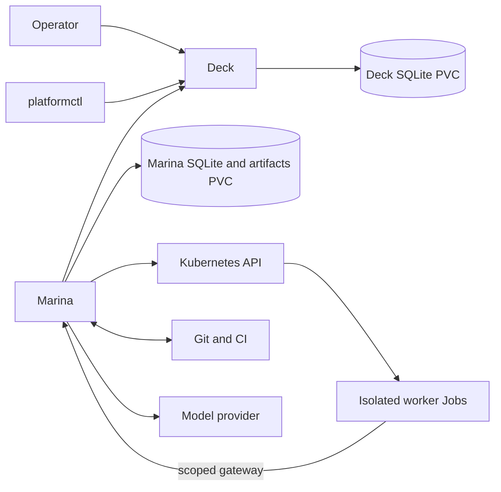

# Architecture

How The Platform is built: the components, how the two loops map onto them, the
tech stack and the rules that keep work safe. Why it exists is in
[VISION.md](VISION.md); what is supported today is in [status.md](status.md).
Planned changes are in [plans/](plans/) until they ship.

Last reviewed: 2026-09-25.

## Components

```text
 browser ──> Deck ──────────── HTTP/JSON API v1 ──────────── Marina ──> Kubernetes
 (channels,  (steering and          ▲                        (execution   isolated
  chat,       the ledger)           │                         and          worker Jobs
  tasks)                        platformctl                   recovery)    (kagent: target)
                                (CLI)                            │
                                                                 ├──> model provider (via Marina's gateway)
                                                                 └──> Git and CI
```

| Component | Role | Owns |
| --- | --- | --- |
| **Deck** (`deck/`) | Where I steer. Web UI with projects, what is happening, and the chat, plus the HTTP API. | Projects, conversations, tasks, budgets, plans, decisions, commands, and the operator-visible record of runs and evidence. Never schedules Pods, clones repositories or calls models. |
| **Marina** (`marina/`) | Where work runs. Claims authorized tasks from Deck and runs them to a result or a blocker. | Repository binding, credentials, execution policy, immutable context packages, runtime attempts, usage, artifacts, verification, and recovery after restarts. |
| **platformctl** (`cli/`) | Terminal client for Deck's public API. | Nothing; it is stateless and never calls Marina. |
| **kagent** (target engine) | Runs the agent harnesses and their lifecycle ([decision 0017](decisions/0017-kagent-core-engine.md)). Trialled, not yet installed; see the [integration plan](plans/kagent-integration.md). | Engine task history and runtime lifecycle. |
| **Git, CI, Kubernetes** | External systems. | Their own facts: source revisions, check results, workload state. |

Deck and Marina are separate products: separate Go modules, binaries, SQLite
databases, identities, images, deployments and migrations. Neither imports the
other's code or reads the other's database. They meet only through Deck's
versioned HTTP/JSON API.

## How the loops map to components

| Part of the vision | Today | Target ([decision 0022](decisions/0022-autonomous-software-factory.md)) |
| --- | --- | --- |
| **Outer loop** (me and the chat agent) | Deck channels and threads. An explicitly invoked conversation agent runs in Marina with no write authority and replies in the thread. Tasks are created by hand or promoted from messages. | The chat agent drafts a PRD; after my approval Marina commits it to the project repository, and top-level tasks are derived from it. Context and knowledge bases come later. |
| **Inner loop** (agents) | Marina starts an isolated coding Job at a pinned revision, then a separate clean verification Job runs the checks. | Native Codex on kagent. Failed checks feed back into bounded repair attempts ([0020](decisions/0020-bounded-repair-policy.md)); an independent review runs before every commit ([0021](decisions/0021-semantic-review-gate.md)). |
| **Landing** | Marina opens a pull request, waits for required CI at the exact head, records evidence and stops for human review. | No pull request: clean verification (unit and end-to-end tests), push to a task branch, required GitHub CI on that commit, then fast-forward main. |
| **CI and deployment** | GitHub. | GitHub. The platform observes CI and never deploys. |
| **Deck UI** | Project channels, threads, a compact task list and a task drawer. | Three columns: projects, a simple middle column (in progress, to do, recently landed), and the chat. |

The diagnostic analysis workflow reuses the same governance: a pinned LangChain
worker analyzes a fixed input and an independent validator checks its report.

## Tech stack

| Layer | Choice |
| --- | --- |
| Services | Go (Deck, Marina, platformctl as three independent modules joined by `go.work`) |
| Web UI | SvelteKit 2, Svelte 5, TypeScript, Tailwind CSS 4, Vite; design system in [deck/web/DESIGN.md](../deck/web/DESIGN.md) |
| Storage | One SQLite database per service (`modernc.org/sqlite`) and artifact files on persistent volumes |
| API | HTTP/JSON with an OpenAPI v1 contract in [deck/api/openapi.yaml](../deck/api/openapi.yaml) |
| Runtime | Kubernetes: local Podman + Kind for acceptance, GKE Autopilot for tests; ephemeral Jobs with NetworkPolicy isolation |
| Agent engine | Codex worker today; kagent with native Codex as the target (A2A protocol, pinned `v1.0.0-alpha1`) |
| Diagnostic workload | Python LangChain harness with hash-pinned dependencies |
| Models | OpenRouter, reached only through Marina's model gateway |
| Git, registry, CI | GitHub, GHCR, GitHub Actions |

Choices and budgets for the installation are in
[decision 0010](decisions/0010-initial-installation-services.md).

## Sources of truth

| Fact | Owner | How the other side uses it |
| --- | --- | --- |
| Project name, description, conversations | Deck | Marina binds the Deck project ID. |
| Repository, default branch, credentials, execution policy | Marina | Deck shows a safe versioned summary. |
| Project knowledge and selected conversation excerpts | Deck | Marina resolves exact approved revisions. |
| Repository files, PRDs, instructions, and build and test definitions | Git | Deck registers references; Marina resolves pinned content. |
| Task outcome, acceptance criteria, priority, budget | Deck | Marina stores the claimed, immutable snapshot. |
| Run, lease, fence, plan, decision, command | Deck | Marina reconciles exact versions. |
| Execution, attempt, usage and cleanup state | Marina | Deck receives summarized projections. |
| Assembled context package | Marina | Deck shows a read-only view. |
| Commits, branches and pull requests | Git provider | Both reference immutable IDs. |
| CI results | CI provider | Marina checks them on the exact commit it delivers. |
| Evidence decisions and artifact bytes | Marina | Deck stores evidence records and proxies downloads. |

Deck's event history explains work to me. Marina's journal recovers execution.
Correlation IDs connect them; they are not competing records. Project context
rules are in [decision 0014](decisions/0014-project-repository-and-knowledge.md).

## Contract

Deck owns the OpenAPI document and the canonical JSON fixtures under
[deck/api/](../deck/api/). Marina owns provider-neutral ports and a reusable
consumer test suite under `marina/internal/workcontrol/`. Deck advertises only
implemented capabilities through `GET /api/v1/provider`; planned fixture schemas
do not make a behavior available.

- Additive changes keep version-1 semantics; breaking changes need a new major
  version.
- Claims and run changes carry an `Idempotency-Key`. Exact retries replay the
  original result; a changed payload is a conflict.
- Changes to an active run also carry the agent ID, the exact run version and
  the current fence token.
- Service credentials are scoped to a project and a capability
  ([decision 0003](decisions/0003-service-authentication.md)).

`make conformance` builds a real Deck, starts it with an isolated database and a
temporary credential, and runs Marina's consumer suite and the CLI against it.

## Rules that keep work safe

1. One component owns each fact.
2. Every external change is idempotent and safe to retry after a lost response.
3. Active-run changes need the exact version and the current lease fence.
4. A claimed task's intent, profile, repository binding and context never change
   during the run.
5. Authority and budgets can only shrink as work proceeds.
6. Workers are disposable; they never hold durable progress or long-lived
   credentials.
7. Completion needs current evidence bound to the source revision.
8. The worker that produced a change is not its only verifier.
9. Text from repositories, tools or conversations is data; it cannot grant
   authority.
10. Secrets are referenced only when needed and never enter task text, context,
    evidence, artifacts or logs.
11. Restart, timeout, cancellation and partial success are normal paths.

Marina never uses a distributed transaction. Every side effect follows the same
pattern:

```text
load durable state -> observe external state -> decide
-> record intent and idempotency key -> perform one action
-> record the observation -> publish through the outbox
```

A lost request or response is resolved by replay or lookup with the recorded key.
Marina never assumes an operation failed and starts replacement work.

## Failure behavior

| Failure | Result |
| --- | --- |
| Deck unavailable before claim | Claim nothing; readiness names the dependency. |
| Claim or completion response lost | Replay the recorded key or look up the original result. |
| Marina restarts | Inspect the recorded run and runtime handle before continuing. |
| Lease or fence expires or is rejected | Stop new side effects and terminate the worker. |
| Model response uncertain | Keep the full reservation; never invent usage. |
| Verification, CI or artifact storage fails | Do not complete; block or wait within budget. |
| Operator cancels | Revoke authority, terminate the worker, clean up, then acknowledge. |
| Delivered commit changes (PR head today, main moved in the target) | Earlier evidence becomes stale; the change is checked again or blocks. |

## Security boundaries

- My browser session (Deck) and Marina's service identity are separate. The
  local installation opens without sign-in
  ([decision 0005](decisions/0005-operator-authentication.md)).
- Each worker attempt gets a short-lived gateway credential only. It has no
  Kubernetes token, Git write credential or model provider key.
- Workers run in their own namespace with resource limits, a read-only root
  filesystem and network access limited to Marina and DNS. NetworkPolicy isolates
  Pods; it is not a VM boundary.

## Deployment

Two single-replica services and short-lived worker Jobs:



Both services use `Recreate` updates and `ReadWriteOnce` storage; neither SQLite
deployment can scale horizontally. Installation guides:
[local Podman/Kind](../deploy/kubernetes/local-podman/README.md),
[repository workflow](../deploy/kubernetes/first-release/README.md) and
[two-workload profile](../deploy/kubernetes/agent-platform/README.md).

## Repository layout

```text
AGENTS.md                     rules for coding agents
docs/                         vision, architecture, status, backlog, decisions, plans, evidence
cli/                          platformctl
deck/                         Deck service and web UI (deck/web/)
deck/api/                     OpenAPI contract and canonical fixtures
marina/                       Marina service and worker harnesses
marina/internal/workcontrol/  provider-neutral consumer contract
deploy/kubernetes/            installation profiles and runbooks
scripts/                      installation and acceptance helpers
```
