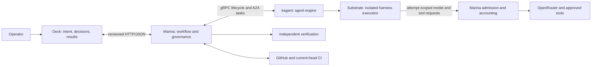

# Evaluating kagent adoption for Marina

- Date: 2026-09-22
- Status: adoption direction accepted in decision 0017; implementation, rollout and removal tracked by KINT-01–15
- Scope: decision plan for kagent as Marina's core agent engine, ownership, evaluation, migration, and rejection criteria
- Evidence: initial documentation/source review below; subsequent isolated runtime proof is recorded in [KINT-01/02](validation/kint-01-02-2026-09-22.md)

Follow-up: the operator accepted the integration direction and requested an
actionable removal plan. [Decision 0017](decisions/0017-kagent-core-engine.md) and
the [implementation plan](kagent-integration-plan.md) now govern execution, with
stable tasks in [TODO.md](../TODO.md#kagent-integration-and-marina-simplification).
The evaluation stages below remain research context; their local KAG IDs are
not a second active backlog. KINT-01–15 incorporate their gates and add delivery
and deletion work. No runtime compatibility proof is implied by accepting the direction.

Subsequent implementation evidence: the [KINT-01/02 local trial](validation/kint-01-02-2026-09-22.md)
now proves the pinned ARM64 stack's native Codex lifecycle and snapshot restore,
retained instance identity, isolation and teardown. It also corrects older
website assumptions: this Substrate chart uses PostgreSQL rather than Redis.
Governed workload and failure-matrix acceptance remain pending.

## Recommendation

**Favor adoption: Deck remains the operator interface, Marina orchestrates the
governed workflow, and kagent becomes the core agent execution engine.** Evaluate
that architecture first, with an explicit path to continue without kagent if the
trial fails. The direction is now accepted; rollout remains conditional on evidence.

Use upstream capabilities wherever they meet the requirement: harness execution,
agent configuration, interaction history, human-input continuation, MCP wiring,
and runtime lifecycle. Marina should retain product-specific authorization,
workflow acceptance, and Deck integration, while progressively shedding generic
agent-platform implementation. A wrapper that adds kagent but retains every
existing execution mechanism would not meet the goal.

The strongest reason to adopt is reduced ownership of agent infrastructure and
access to maintained harness integrations. The strongest reason to decline is
that the required integration and operational stack might cost more than they
remove. Existing investment in Marina does not decide the outcome.

## Why reconsider Marina

The operator favors adopting kagent and questions whether Marina adds enough
value as a separate product when an existing project already addresses much of
the agent-platform problem.

That concern is justified. If the requirement is to run agents on Kubernetes,
connect models and tools, provide conversations and approvals, and inspect
execution, kagent has substantial overlap. Building those capabilities ourselves
needs a concrete justification.

The broader desired outcome is to delegate bounded repository work, disconnect,
and return to a verified pull request or a clear blocker. The review has not
established whether kagent supplies that complete workflow with the required
failure behavior. This is an evaluation question, not evidence that kagent lacks
those capabilities or that Marina must remain a separate product.

Existing code and engineering effort are not reasons to preserve the current
architecture. A smaller integration on an existing platform may provide the
same value with less maintenance. Novelty is not required for a useful personal
tool, but duplicated infrastructure should earn its continued ownership.

## What the projects do

| Project | Role | Relevance to this installation |
| --- | --- | --- |
| **kagent** | Deploys and runs AI agents on Kubernetes, with model/tool configuration, conversation runtimes, and a dashboard. | Primary adoption candidate for the agent-platform foundation. |
| **agentgateway** | Routes agent traffic to models and tools and applies authentication, authorization, and observability. | Possible shared connectivity layer as external tool integrations grow. |
| **OpenRouter** | Supplies the installation's existing access to model providers. | Retain as the current model destination while evaluating compatibility. |
| **agentregistry** (`aregistry.ai`) | Catalogs reusable agents, MCP servers, skills, and prompts; its documented Kubernetes deployment path uses kagent. | Consider when maintaining and sharing many components becomes a real need. |
| **kgateway** | Provides Envoy-based Kubernetes Gateway API ingress and API traffic management. | Revisit if installation networking needs become more complex. |

These projects occupy different layers. Adopting kagent does not by itself
require adopting all of them. See the official sources below for the reviewed
capabilities.

## Kagent overlap and remaining questions

The following describes broad overlap. The pinned-release findings below take
precedence over examples on the moving `0.x` documentation site.

| Need | Assessment | What to establish |
| --- | --- | --- |
| Run agents on Kubernetes | Strong documented overlap. | Whether the required harness can run with suitable isolation and lifecycle controls. |
| Connect models, tools, and frameworks | Strong documented overlap. | Compatibility with our chosen harnesses, OpenRouter, and credential boundaries. |
| Agent conversations and questions | Directly relevant to planned conversation work. | Persistence across disconnects/restarts and correct routing of answers and results. |
| Human approval of tool actions | Documented by kagent. | Exact action binding, expiry/revocation, replay behavior, and alignment with task authority. |
| Traces and execution inspection | Documented OpenTelemetry integration. | Correlation with task/run/attempt identities without exposing secrets or private content. |
| Authorized task to verified PR | Requires an end-to-end evaluation. | Coding, independent verification, PR publication, current-head CI, and truthful completion. |
| Recovery, budgets, and cancellation | Our exact guarantees are unverified in kagent. | Lost responses, duplicate prevention, durable accounting, ownership expiry, and observed termination. |
| Immutable context and evidence | Mapping is unverified. | Pinned inputs, provenance, revocation, and acceptance tied to the exact output revision. |

The current baseline is described in [the architecture](../ARCHITECTURE.md),
[the repository-workflow acceptance report](validation/poc-mvp-2026-09-21.md),
and [the two-workload acceptance report](validation/agent-11-13-2026-09-22.md).
It already has important limits: one active task, one implementation and separate
verification attempt, safe blockers after some interruptions, and no transparent
harness-step recovery, automatic repair loop, merge, or deployment authority.
Evaluate against those actual guarantees; do not invent stronger requirements
to protect the existing implementation.

## Agentgateway, OpenRouter, and MCP

OpenRouter already supplies model access and provider routing for Marina. Adding
agentgateway solely for model routing has limited immediate benefit in this
installation. It does not follow that the two products are equivalent:
agentgateway also addresses access to tools and agent traffic.

MCP servers expose tools to agents. They can run on Kubernetes alongside the
agents or at remote endpoints. Agents can connect directly to them. An optional
gateway topology is:

```text
Agent -> agentgateway -> MCP server -> underlying service
```

For example, an MCP server could expose GitHub or monitoring operations.
Agentgateway becomes useful when centralized identity, per-tool access policies,
and traffic inspection simplify managing several such servers. Hosting MCP
servers on Kubernetes does not by itself require a gateway or grant agents
permission to use their tools.

Marina's current gateway also performs task-specific admission and durable budget
accounting. An integration must assign ownership of those controls explicitly.
One candidate boundary, if Marina retains them, is:

```text
Worker -> Marina admission/accounting -> agentgateway -> approved model or tool
```

This is a design option, not an implemented integration or a prescribed final
architecture. External authorization may provide another connection point.
Retries, authorization caches, cancellation, streaming failures, and unknown
usage must preserve the selected safety guarantees. Gateway metrics alone do
not establish durable task-budget enforcement.

## Pinned candidate and findings

GitHub's latest-release endpoint on 2026-09-22 returned
[`v1.0.0-alpha1`](https://github.com/kagent-dev/kagent/releases/tag/v1.0.0-alpha1),
published 2026-09-18, resolving to commit
`850c464726881317997c32515f8b621b949d6ce1`. Use that commit for this analysis.
Despite the GitHub release metadata marking it non-prerelease, treat the explicit
alpha version as an evaluation candidate, not a stability guarantee. The release
list also contains `v0.10.1`; examine that separately only if the alpha's deployment
requirements or compatibility block the trial. Do not combine their capabilities.

The pinned source describes a materially different architecture from the public
`0.x` examples. In particular, its configuration uses `Harness` and
`AgentTemplate` resources under `kagent.dev/v1alpha3`, with PostgreSQL-backed
`AgentInstance` identities exposed through gRPC. A2A supplies public task
interaction, and Substrate Actors execute the harnesses. This is a substantive
engine replacement, not simply another Kubernetes Job image.
[Source: pinned architecture][k-architecture].

| Finding at the pinned revision | Implication for Marina | Evidence level |
| --- | --- | --- |
| Harness compilation covers kagent Go ADK, Codex, Claude, and BYO; instances pin immutable prepared revisions. | Test native Codex first for repository work. A BYO wrapper is a compatibility option for the pinned LangChain workload, not the default for everything. | Pinned [configuration design][k-compilation]; no local execution proof. |
| The gateway persists ordered task events before publication and specifies message-ID/request-hash deduplication, conflicts on changed reuse, and one active task per instance history. | Reuse durable engine history and invocation semantics; test the mapping to Marina attempt identity and lost responses. | Pinned [gateway design][k-a2a] and selected gateway source/tests inspected, not run. |
| Lifecycle workflows persist transitions; runtime/quiescence coordination is in memory and explicitly limits the gateway to one replica. | Single-replica operation fits the pilot. Restart safety remains a test, and generic HA documentation must not override this release-specific limit. | Pinned [runtime design][k-lifecycle]. |
| HITL correlates questions and approvals to the same task and pending operation. The new tool-binding API does not expose generic per-tool approval configuration; Codex compilation currently disables approvals by policy. | Reuse actual emitted questions, but retain external authority enforcement. Do not assume the `0.x` `requireApproval` example works with v1alpha3. | Pinned [HITL][k-hitl] and [compilation][k-compilation] documents. |
| Named checkpoints require terminal boundaries; input-required/auth-required tasks are not checkpointable or forkable. The persistence document also warns of development schemas without upgrade paths. | Conversation pause, checkpoint, and safe replay are different things. Inspect the release's real migration path before keeping valuable state in it. | Pinned [persistence design][k-persistence]. |
| Model configuration supports custom base URLs and explicit `chatCompletions` or `responses` formats. | Try Responses through Marina's admission gateway first. Matching an API format alone does not prove compatibility with its restricted request/tool contract. | Pinned [ModelConfig types][k-model]. |
| Substrate v0.2.0-beta4 injects destination-scoped credentials outside the runtime; matching is by hostname, and rotation may take five minutes. | Useful overlap with secret isolation, but it does not establish task fencing, immediate revocation, or durable budget enforcement. Test all three independently. | Pinned [credential design][k-credentials]. |
| Helm values include PostgreSQL, optional bundled Substrate, and several enabled tool components; controller authentication defaults to `unsecure`. | Render a minimal installation, restrict access, and inspect actual dependencies/RBAC. Never adopt the default chart wholesale as the governed installation. | Pinned [chart values][k-values]. |

The website describes Substrate's gVisor workers, Redis-backed control plane,
proxy, node components, and object storage. Verify the exact dependency versions,
licenses, ARM64 images, kernel/privilege requirements, and snapshot storage support
for the pinned release on local Podman/Kind. Its stack is substantially larger
than Marina's present Jobs and SQLite; no measured resource comparison exists yet.
[Source: Substrate documentation](https://kagent.dev/docs/kagent/0.x/concepts/agent-substrate/).

These findings strengthen adoption: upstream already addresses several concerns
previously listed only as unknown. They do not establish the complete Deck-to-PR
workflow or its installation-specific safety properties. This was a targeted
source review, not an exhaustive implementation or security audit.

## Proposed target: kagent engine, Marina workflow, Deck interface



This is a proposed topology. The first compatibility proof must establish that
Substrate egress and kagent model/tool configuration can actually enforce it.
Substrate manages its own runtime infrastructure; any additional destinations
must be explicitly inventoried. Retain OpenRouter. Add agentgateway only if it
removes a demonstrated routing or tool-policy burden, with a single owner for
accounting and retries.

| Responsibility | Proposed owner after adoption | Change from today |
| --- | --- | --- |
| Human intent, task budgets, decisions, thread identity, visible results | Deck | Preserve public semantics and the operator entry point. |
| Claims, Deck leases/fences, workflow transitions, result publication | Marina | Keep the cross-system journal and outbox; reference engine observations. |
| Harness launch, model loop, native framework state, engine task events and runtime continuation | kagent/Substrate | Replace overlapping custom harness hosting and engine-state machinery. |
| Agent behavior and installed harness configuration | kagent resources, selected by Marina profile | Profiles pin exact compiled inputs/revisions; do not silently follow latest. |
| Immutable authorized context and source revocation | Marina, with Deck/Git as source owners | Deliver pinned inputs into the engine; inspect whether upstream revision machinery can remove duplicate packaging. |
| Per-attempt admission, shared budget reservations, allowed side effects | Marina initially | Retire pieces only when an upstream mechanism passes the same external enforcement tests. |
| Pending engine question/continuation | kagent | Deck owns the human answer/decision; Marina correlates and delivers it once. |
| Git mutation, PR/CI acceptance, independent validation, evidence admission | Marina | Remain workflow rules even if execution moves to upstream infrastructure. |
| Raw engine traces/history | kagent | Deck gets normalized, linked projections; Marina does not copy the entire engine ledger. |

Three stores are acceptable if they own different facts: Deck's work ledger,
Marina's workflow journal, and kagent's engine history. No shared database access.
An A2A task being completed means an engine interaction ended; it cannot by itself
mark the Deck task successfully completed.

For the target architecture, the kagent UI is an optional diagnostic/admin
surface. Normal task invocation and human decisions go through Deck. Direct
engine access must not bypass task authorization. Replacing Deck is a separate
product choice and is not necessary to prove the user's preferred architecture.

### Integration contract to prove

Start at Marina's existing [runtime port](../marina/internal/runtime/runtime.go),
not a new general-purpose orchestration framework. Keep kagent types inside an
adapter. If engine interactions need a small additional contract, demonstrate
that need with one workload before widening the port.

- **Identity and start:** persist Deck task/run, Marina execution/attempt, start
  key, profile/context digests, and selected engine revision before dispatch.
  Record the instance route plus A2A context/task/message IDs. Prove recovery
  after losing either the instance-create or message-send response. A2A message
  deduplication does not automatically make instance creation idempotent.
- **Revision binding:** instance creation currently selects the latest successful
  revision for its template/harness pair. Prove exact selection, or use immutable
  per-profile resources and verify the returned revision before invoking it.
  Detect a concurrent edit rather than executing a different profile.
- **Observe and reconnect:** map durable status/events through an idempotent
  cursor or event identity; tolerate duplicate, missing, and reordered delivery.
  Inspect the existing engine task after timeout. Never turn stream loss into a
  new implementation attempt or a success claim.
- **Authority and usage:** associate every model/tool call with the active
  attempt and current fence. All upstream retries, subagent calls, and any
  summarization count against the same bounded budget. Retain unknown usage
  reservations. Initially disable optional memory and delegation to minimize the
  execution surface; add them only with explicit context/authority rules.
- **Questions and decisions:** bind each Deck record to the engine instance,
  task, request/call ID, exact arguments, and applicable authority/version.
  Recheck expiry and cancellation before forwarding an answer. Reject stale or
  duplicate answers without executing the action twice. A framework pause does
  not advertise Marina's unsupported operator pause/resume commands.
- **Cancel and cleanup:** revoke admission first, request engine cancellation,
  and confirm the relevant compute and child tools have stopped before reporting
  cancellation. If task cancellation cannot establish this, test instance
  termination. One attempt per instance is the initial isolation choice; do not
  terminate unrelated work in a shared instance.
- **Artifacts and completion:** collect bytes and digests into Marina's evidence
  boundary; distrust arbitrary artifact URLs and engine success text. Independent
  checks still bind the exact source/output revision. Keep evidence accessible
  after engine cleanup.

The existing [model gateway](../marina/internal/workerapi/model.go) accepts a
restricted Responses protocol, checks stage/tool authority, and reserves usage
before forwarding. Test native Codex and ADK payloads, streaming, TLS, and
attempt credentials against it. Changing a `baseUrl` is not enough; kagent's
built-in tools or retained-session fields may require a deliberately versioned
profile or request adaptation. Do not relax validation merely to make a demo run.

### What to reuse, replace, or retain

| Current area | Adoption experiment | Intended disposition |
| --- | --- | --- |
| `marina/internal/kubernetes` and worker lifecycle | Implement start/inspect/cancel through kagent. | Retire direct agent-worker Job hosting after equivalent proof; a clean deterministic verifier may remain a Job. |
| `marina/internal/worker` and harness-specific launch code | Use native Codex; test native ADK against the diagnostic fixture and BYO for LangChain compatibility. | Remove redundant launch/agent-loop glue; keep only adapters that serve an actual requirement. |
| `marina/internal/flow`, `reconcile`, `journal`, `execution` | Separate workflow facts from engine-owned facts. | Retain durable cross-system coordination; shrink duplicated runtime state only after migration evidence. |
| `marina/internal/workerapi` | Reuse admission/accounting, expose only the needed governed tools through MCP if appropriate. | Retain task-specific enforcement; consider upstream routing/credential features independently. |
| `marina/internal/contextpack`, `policy`, `sourcecontrol`, `artifacts`, `analysis` | Run existing acceptance rules over engine-produced outputs. | Preserve product semantics; replace mechanics where upstream demonstrably covers them. |
| CHAT-04/05/07 | Reuse engine conversations, questions, and events. | Build Deck routing and projections, avoiding a second custom agent conversation engine. |
| AUTO-01–07 | Later feed verified feedback into bounded engine interactions. | Keep attempt/budget/evidence rules in Marina; no automatic repair capability is implied by adoption. |

The LangChain choice in decision 0015 remains current. Trying ADK on the same
fixture is a comparison, not permission to silently remove that harness. If
native ADK makes retaining LangChain unnecessary, record the explicit superseding
decision and profile migration. BYO hosting alone can preserve compatibility, but
does not prove that meaningful custom engine code has been eliminated.

## Executable evaluation plan

These are local evaluation IDs, not completed items or changes to `TODO.md`.
Recommended planning allowance: five focused engineering days through the
decision, with an early stop after feasibility. This is an estimate, not an
approved spend or a reason to waive failed gates. If more time is needed, report
the concrete blocker and revised estimate before expanding the experiment.

For every test record: candidate/image/chart digests, environment, initial state,
injected failure, expected and observed behavior, redacted IDs/logs, and whether
the result is native, configuration, Marina integration, or missing. Put results
under `docs/validation/`; this plan itself is not acceptance evidence.

| ID / order | Work and owner | Exit evidence |
| --- | --- | --- |
| KAG-01 — feasibility, first day | Marina/Ops: lock the candidate, CRDs, protobuf/A2A versions, images and transitive dependencies/licenses. Render Helm and inspect source migration notes. Verify ARM64, local Substrate prerequisites, storage, RBAC, authentication and runtime egress. | Minimal reproducible install design, resource request totals, required changes and compatibility risks. Stop early if local execution requires an unacceptable infrastructure change. |
| KAG-02 — bounded runtime slice, days 1–2 | Marina: install an isolated trial and connect one kagent agent through governed model access. Run the fixed diagnostic fixture with the existing independent validator; exercise one allowlisted context read and one denied read. | Pinned input/output/evidence, usage and credential isolation; start/lookup/observe/cancel mapping; no repository authority. |
| KAG-03 — repository workflow, days 2–3 | Marina: native Codex from one Deck-authorized task, immutable checkout/context, clean verification, controlled publication and current-head CI. Use the existing authorized acceptance repository only within its configured mutation scope. | Exactly one PR ready for human review, or a truthful blocker. A failure must be resolved or explicitly disqualify repository adoption; a diagnostic demo alone cannot pass. |
| KAG-04 — failure gate, days 3–4 | Marina/Joint: run the matrix below against real processes and the trial runtime. Write failing regression tests first for any integration fixes. | No duplicate side effects, authority/budget bypass, false completion, or premature cancellation; safe blockers allowed where the current baseline blocks. |
| KAG-05 — conversation and operations, days 4–5 | Joint/Ops: bridge one persisted engine question through Deck, disconnect/reconnect, answer once, and publish one result. Restart components separately; rehearse pinned upgrade and rollback. | Same task/thread and pending question after reconnect, result visible once, retained evidence/history, measured idle/active resources, documented schema compatibility. This is a spike, not completion of CHAT-01–10. |
| KAG-06 — decision, day 5 | Operator with evidence prepared by Marina/Deck maintainers: compare core adoption, limited use, and no adoption. | ADR with all hard gates, measured costs, code removal list, remaining work, chosen version, and cutover/rollback decision. Unknown mandatory behavior stays failed/unproven. |

Use the existing [local Podman/Kind profile](../deploy/kubernetes/local-podman/README.md),
explicit context `kind-marina-local` and connection `podman-machine-default-root`.
Keep Deck accessible at `https://localhost:8443`. Read the installation guide and
private configuration before deployment; isolate trial resources and volumes,
inventory cluster-scoped CRDs, and preserve the current installation. Use one
controller/gateway replica. Restrict direct APIs, narrow controller RBAC, and
disable unrelated bundled tools. Snapshot storage must be a verified supported
local configuration or an explicitly costed authorized alternative; do not
assume local S3 compatibility or GKE support from the website description.

No live trial is performed by this analysis. A later trial uses existing local
testing authority; new intake, credentials, model spend, and Git mutations still
need their configured task scope. GCP is optional and requires the infrastructure
repo checks and total EUR 10/month budget in decision 0010. Do not turn a local
compatibility problem into an unreviewed cloud migration. Laptop-off operation,
multi-replica HA, production access, merge/deploy authority, and full checkpoint
replay are not acceptance gates for this decision.

### Mandatory failure matrix

| Test | Passing observation |
| --- | --- |
| Duplicate start/send; lose instance-create and send responses separately | Original instance/attempt recovered or safely blocked; no replacement coding work or duplicate billed invocation through blind retry. |
| Restart Marina, kagent gateway, agent compute and engine database separately during work | Inspect the original identities; resume where proven or block truthfully. No invented completion or uncontrolled second attempt. |
| Disconnect event stream; duplicate/out-of-order events | Reconstruct committed engine state and publish each logical Deck transition/result once. |
| Cancel during a model call, tool call, and waiting-for-input state | Admission revoked; termination observed; late responses cannot publish new mutations or revive the run. |
| Lose Deck/lease ownership; expire or revoke context | Further calls denied and compute stopped under the current fence rules. Credential-cache freshness cannot substitute for revocation. |
| Exhaust time/tokens/cost; lose final streaming usage | Deny further consumption, keep unresolved reservations, report known and unknown usage separately, including internal retries. |
| Bypass Marina via model egress, MCP, engine API, or child delegation | No unauthorized provider/tool access or task invocation; no upstream secret, Git write credential, or Kubernetes token available to agent code. |
| Fail verification; change PR head; fail required CI | Evidence becomes failed/stale and Deck cannot show successful completion. |
| Lose commit/PR/publication response | Reconcile the original source operation and outbox receipt; no duplicate PR or false failure followed by a new mutation. |
| Edit template/model/tools while an instance starts or runs | Authorized revision remains pinned, or mismatch blocks before invocation. |
| Answer a question twice, after expiry, or after cancel | Correct pending operation only; reject stale answers and preserve the original human decision. |
| Fail artifact storage or cleanup; upgrade and roll back | No completion without retained evidence; cleanup remains visible/retryable and existing history remains readable. |

## Decision rule

**Adopt kagent as core** when all of the following are demonstrated:

1. Both current workload outcomes remain supported, with the mandatory failure
   matrix passing at the existing release boundary. Upstream features may exceed
   that boundary, but those extras do not compensate for a regression.
2. kagent is on the real execution path and owns harness runtime/lifecycle and
   interaction history; the integration can remove or avoid substantial generic
   engine implementation. At least one native harness must pass, so an opaque
   BYO wrapper around the entire existing engine is insufficient.
3. The integration uses public, pinned APIs without a required long-lived fork,
   private database reads, or broad authority. A small upstream contribution is
   acceptable only with a bounded compatibility plan; speculative upstream fixes
   do not count as passing evidence.
4. The complete installation fits measured local capacity and existing spending
   limits, with acceptable upgrade/rollback behavior. No mandatory proprietary
   service or unsupported storage/runtime assumption remains.
5. The decision names code we will delete, services we will add, ongoing upgrade
   work, and user-visible benefits. The operator accepts that tradeoff explicitly.

Evaluate the economic comparison using measured idle/peak CPU and memory, PVC and
snapshot growth, startup and completion latency, model usage, deployment steps,
custom integration/test code, release churn, and estimated maintenance effort.
Compare the same fixtures, authority, models where compatible, and output checks.
Line count and a shorter demo are supporting data, not success measures. This
does not reopen the previously declined VALUE-01 provider-billing study.

| Result | Decision |
| --- | --- |
| All hard gates pass and ownership decreases meaningfully | Adopt the proposed Deck → Marina → kagent architecture; make kagent the default engine for newly authorized migrated profiles. |
| Only conversation/diagnostic use passes | Consider a deliberately limited integration, with named scope and expiry/review date. Do not call this core-engine adoption or keep two engines indefinitely by accident. |
| Safety, local feasibility, public API compatibility, or maintenance gates fail | Continue with the current Marina engine; record the failing version/test and the upstream or local change that would trigger reevaluation. |
| Evidence is incomplete at the timebox | Defer the decision, retaining the current release; state exactly which tests remain and the bounded cost of resolving them. |

The recommended outcome remains core adoption. The strongest open risks are
Substrate's local footprint/compatibility, exact invocation and cancellation
recovery, mediated usage/authority, and alpha API/schema churn. A missing generic
MCP approval switch alone need not reject adoption: pre-authorized bounded tools
can remain externally governed. It does reject any claim that native tool
approvals already replace Deck's authority model.

## Cutover and rollback after an adoption decision

1. Record an ADR explicitly revisiting decisions 0010, 0015 and 0016, and update
   architecture, vision, installation guides and stable backlog IDs together.
   State which CRD/Substrate dependencies are now justified and which LangChain
   and profile guarantees remain. Do not rewrite historical acceptance reports.
2. Keep the current engine during the trial. Pin the selected engine/version per
   profile and execution; never switch an active run to another engine after an
   uncertain response. Drain existing work before changing defaults.
3. Cut over one new diagnostic profile, then one repository profile after each
   has its own evidence. Preserve historical context, decisions, artifact bytes,
   source identities and old execution inspection. Do not attempt an in-flight
   database translation or transparent session migration.
4. Keep the previous installation configuration/images and protect stores before
   schema-changing upgrades. Rehearse rollback in trial data first; an image
   downgrade alone is not a database rollback. Failed rollback compatibility
   blocks cutover until a concrete preservation path exists; full backup
   automation remains deferred as in the current pilot.
5. On rollback, disable new kagent intake, revoke/terminate trial-owned active
   work and reconcile its side effects. Route only newly authorized tasks to the
   old engine. Retain engine history for inspection; never automatically rerun
   an uncertain mutation in the old engine.
6. Remove replaced launch/runtime code once both profiles and rollback pass.
   Retain independent verification and the small amount of governance code that
   the evidence shows is still necessary. Give any temporary dual-engine period
   an explicit exit item and review date.

For implementation, run Marina's relevant tests and `make -C marina check`;
installation changes need `make check-installation` and local runtime evidence.
Joint protocol changes require `make check` and `make conformance`, keeping Deck's
OpenAPI, fixtures and consumer contract synchronized. A source review, mocked
adapter, or successful upstream test suite cannot substitute for the live matrix.

The implemented architecture and supported capabilities remain current until
the corresponding integration and rollout are complete. The follow-up KINT
backlog now tracks that work and supersedes this document's local evaluation IDs.

## Related direction and sources

Internal records to revisit if adoption changes ownership or product scope:

- [Decision 0009: conversation and inbox](decisions/0009-asynchronous-agent-work.md)
- [Decision 0015: bounded agent platform and LangChain harness](decisions/0015-marina-agent-platform.md)
- [Decision 0016: invocation, context tools, and inspection](decisions/0016-workload-invocation-and-context-tool.md)
- [Current backlog](../TODO.md)

Moving official documentation used for orientation on 2026-09-22:

- [Kagent architecture](https://kagent.dev/docs/kagent/0.x/concepts/architecture/)
- [Kagent human-in-the-loop example](https://kagent.dev/docs/kagent/0.x/examples/human-in-the-loop/)
- [Kagent tracing](https://kagent.dev/docs/kagent/0.x/observability/tracing/)
- [Agentgateway overview](https://agentgateway.dev/)
- [Agentgateway MCP authorization](https://agentgateway.dev/docs/standalone/latest/documentation/mcp/mcp-authz/)
- [Agentgateway external authorization](https://agentgateway.dev/docs/standalone/latest/documentation/configuration/security/external-authz/)
- [Agentregistry architecture](https://aregistry.ai/docs/about/architecture/)
- [Kgateway overview](https://kgateway.dev/)

The pinned source links below support the release-specific findings. Neither
documentation nor source inspection constitutes local acceptance evidence.

[k-architecture]: https://github.com/kagent-dev/kagent/blob/850c464726881317997c32515f8b621b949d6ce1/docs/architecture/README.md
[k-compilation]: https://github.com/kagent-dev/kagent/blob/850c464726881317997c32515f8b621b949d6ce1/docs/architecture/configuration-and-compilation.md
[k-a2a]: https://github.com/kagent-dev/kagent/blob/850c464726881317997c32515f8b621b949d6ce1/docs/architecture/a2a-gateway.md
[k-lifecycle]: https://github.com/kagent-dev/kagent/blob/850c464726881317997c32515f8b621b949d6ce1/docs/architecture/runtime-and-lifecycle.md
[k-hitl]: https://github.com/kagent-dev/kagent/blob/850c464726881317997c32515f8b621b949d6ce1/docs/architecture/human-in-the-loop.md
[k-persistence]: https://github.com/kagent-dev/kagent/blob/850c464726881317997c32515f8b621b949d6ce1/docs/architecture/persistence-checkpoints-and-forks.md
[k-model]: https://github.com/kagent-dev/kagent/blob/850c464726881317997c32515f8b621b949d6ce1/go/api/v1alpha3/modelconfig_types.go
[k-credentials]: https://github.com/kagent-dev/kagent/blob/850c464726881317997c32515f8b621b949d6ce1/docs/architecture/credential-injection.md
[k-values]: https://github.com/kagent-dev/kagent/blob/850c464726881317997c32515f8b621b949d6ce1/helm/kagent/values.yaml
