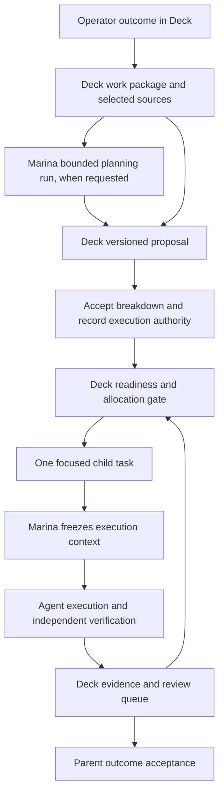

# Backlog to focused agent work

- Status: implementation design; no new runtime capability implemented
- Decision: [0018](decisions/0018-deck-work-preparation.md)
- Tracking: PREP-01–08 in [TODO.md](../TODO.md)

## Outcome and first slice

An operator enters a broad outcome in Deck, refines it into reviewable child
tasks, checks each child's context and verification plan, and authorizes bounded
execution. Deck presents progress and decisions against the original outcome.
Marina executes each eligible child and returns evidence through the existing
ledger. A task already small enough can continue through the existing direct
path without a mandatory parent or planning agent.

First deliver manual preparation for one project/repository, one parent level,
and one active child at a time. Then add agent-assisted proposals. Do not require
conversation UI, recursive agent delegation, a generic workflow editor, a new
service, or a retrieval platform to deliver the first slice.

## Ownership and records

The following are proposed domain records, not published API schemas. Reuse
existing tasks for executable children and existing decisions/evidence by ID.
Do not reuse `PlanRevision` as the decomposition: it currently belongs to one
claimed run and binds that run's execution plan and context digest.

| Record | Owner and minimum contents |
| --- | --- |
| Work package | Deck: project ID, outcome, acceptance criteria, priority, version, source references, authority ceiling, aggregate budget, deadline, review capacity, and originating task/message references. It is not claimable work. |
| Breakdown revision | Deck: parent version, immutable proposal, author/planning-run identity, input digest, child keys, dependencies, criterion coverage, open questions, risk, and acceptance/rejection decision. |
| Child task brief | Deck: existing task plus parent/breakdown identity, one outcome, scope/exclusions, criterion mapping, verification requirements, profile reference, context selection, and budget allocation. |
| Dependency | Deck: same-parent prerequisite and required evidence/input revision; no cycles, self-links, or cross-project edges in the first slice. |
| Authorization/allocation | Deck: exact accepted revision, actor or policy reference, permitted children, authority, reserved limits, release state, and idempotency identity. |
| Execution and usage | Marina: existing journal, lease/fence, context package, attempts, actual usage and unresolved reservations; Deck holds attributed projections and allocation receipts. |

Keep package states separate from current task/run status enums: draft,
prepared, authorized, active, awaiting acceptance, accepted, blocked, cancelled.
Derive progress from child records. All children producing their required outputs
makes the parent eligible for acceptance; it does not itself prove the parent
outcome. Parent acceptance records evidence coverage and an operator decision in
the first slice. If the parent goal is delivery, PR readiness is partial progress.

## Preparation and dispatch

1. **Capture intent.** Save a package in backlog with outcome, acceptance criteria,
   exclusions, priority and selected project sources. Missing information stays
   visible. No execution starts merely because a description mentions an agent.
2. **Draft the breakdown.** Manually add children, or explicitly authorize a
   bounded read-only planning workload. Planning consumes an allocation of the
   same aggregate budget. Its input includes the exact parent version, selected
   context, installed profile choices, limits and verification expectations.
3. **Validate the proposal.** Require unique stable child keys, finite child count,
   acyclic dependencies, same-project references, acceptance-criterion coverage,
   budget fit and compatible profiles. Each child declares a deliverable,
   verification method, scope/exclusions and required inputs. A structural check
   cannot establish semantic completeness; show assumptions and coverage for
   operator judgment. A child lacking a cheap credible check returns to refinement.
4. **Accept and authorize.** In one Deck transaction, accept one exact breakdown
   revision and materialize its children in backlog with stable IDs. Separately
   record which children may execute, or do both in one explicit action. An agent
   proposal has no authority to do either. Replay returns the same child IDs;
   a stale parent or changed request conflicts. A superseding proposal may replace
   unstarted drafts explicitly, but cannot rewrite active or completed work.
5. **Release eligible children.** Deck checks authorization, dependencies, current
   selection validity, profile availability, allocation and review capacity before
   making a child ready. Priority orders only eligible work. Recheck persisted
   guards in the claim transaction so stale listing, task movement, workload
   invocation, direct claims, and browser requests cannot bypass preparation.
6. **Execute.** Marina claims through the existing lease/fence contract, independently
   checks authority and budget, freezes actual inputs, and runs the supported
   workflow. It may block on a context problem even after Deck's metadata checks
   pass. It never repairs a brief by silently broadening scope.
7. **Review and continue.** Evidence and focused blockers appear against child and
   parent. Satisfied prerequisites permit the next already-authorized child.
   Missing decisions stay in Deck. New work discovered during execution becomes
   a proposal or linked follow-up, not implicit permission for additional tasks.

Keep execution sequential at the current installation limit. For the first
slice, default to one unreviewed child result per package; make the selected
capacity explicit before authorization. Count released/running children as
reserved review slots so generation cannot race ahead of the review gate.
Persist a package review acknowledgement against the exact result revision;
reuse INBOX reviewed-state implementation when available. Reading a result is
not acceptance, and review is not evidence that a prerequisite code change exists.

## Focused context, with two freeze points

Deck prepares the selection; Marina assembles the content. Extend CTX's explicit
sources with a per-child selection and reasons for inclusion. Keep required
project/repository guidance mandatory; narrow optional reference material.
Reusing a parent's source set need not send all parent material to every child.

At child authorization, freeze the brief, exact source/message/decision revisions,
profile and repository binding using existing context semantics. If a child
needs an output that does not exist yet, leave it in authorized backlog with an
explicit unresolved prerequisite, not a falsely complete context selection.
At release, bind that prerequisite to an exact accepted evidence/artifact/source
revision and finalize the child selection in a versioned transaction. This is
permitted only by the recorded dependency rule; a changed brief, unrelated source,
or authority expansion requires new authorization.

Before execution, Marina resolves the pinned repository commit and selected
references, combines them with task and installed policy, then persists a
content-addressed package. Show the operator the intended selection and actual
manifest, including omissions, provenance, trust, digests and size. Preserve the
current assembly bounds until deliberately revised. If required material cannot
fit, block for refinement; do not silently truncate it or substitute an uncited
summary. Optional omissions require a recorded reason. Source access remains
restricted to authorized inputs; a useful file suggested by a worker is not
permission to retrieve an arbitrary source.

Never copy full channel history or a previous agent session by default. A handoff
contains the result, exact artifact/source references, verification evidence and
remaining questions. Agent summaries remain attributed data, not trusted project
guidance. Context cannot widen authority. Ordinary source edits affect future
selections; active runs recover their recorded package. Revocation/expiry stops
further use under existing termination rules, and blocks release of affected
queued children. No semantic contradiction detector is assumed.

## Dependencies and truthful completion

A repository child completing means a verified PR ready for human review, not a
merged change. If child B needs code from A, A's successful run alone cannot
release B. Initially require the operator-controlled merge and a Marina-observed
base commit containing the prerequisite, with evidence at that revision. Capture
that exact commit as B's required input and independently verify B. If the PR
changes, closes unmerged, or the expected input is absent, B stays blocked.
Automated merge, stacked PR orchestration and shared mutable branches are outside
this slice. For a report prerequisite, bind the exact validated artifact digest.

For example, "add CSV export" may produce: define the format contract; implement
export plus tests against the accepted contract; add the UI plus tests after the
API change is available in the base revision. Each child has its own selected
sources and verification. The parent remains awaiting acceptance until its
end-to-end criteria have current evidence. A contract change across Deck and
Marina that must ship atomically stays one coherent child; decomposition must
not create incompatible intermediate releases just to make tasks smaller.

## Budgets, cancellation, and recovery

Reserve child limits from the parent ceiling before release. Start conservatively:
sum of all allocations, including planning and verification, must fit the total
cost/token/attempt limits; share the parent deadline and do not multiply time or
concurrency by the number of children. Repository children still need the current
minimum implementation and verification attempts. Authority is the intersection
of parent authorization, child grant and installed Marina policy.

Deck owns allocation ceilings, Marina owns execution metering. Keep reservations
until a terminal, deduplicated usage/termination receipt resolves them. Ambiguous
model usage retains its full reservation. Only confirmed unused capacity may be
released; deleting a child or restarting either product never resets expenditure.
A new planning revision also needs an allocation. Parent budget changes require
explicit new authorization and cannot silently raise an active run's limits.

Parent cancellation atomically disables further release and records cancellation
intent for active children. Reconcile it into existing child cancel commands using
stable keys. A claim racing cancellation either fails the gate or appears in the
set to cancel. A parent becomes cancelled only after Marina observes termination
and reconciles usage. Completed evidence remains inspectable. A failed or cancelled
prerequisite blocks dependents; retry/repair remains a separately authorized
follow-up until AUTO behavior exists.

No cross-service transaction is required. Deck commits proposal acceptance,
children, allocations and audit history atomically in its store. Marina journals
planning/claim/publication intent before calling Deck and replays the same keys
through its outbox after outages. A proposal arriving after cancellation or from
an old parent version is retained as history but cannot materialize or release
work. Resume from stored IDs and revisions; do not regenerate a breakdown merely
because a response was lost.

## Implementation boundaries and contract

| Area | Existing extension points and required work |
| --- | --- |
| Deck domain/store | `deck/internal/domain/`, `deck/internal/store/tasks.go`, `runs.go`, `context.go`, `workloads.go`: additive package/proposal/dependency/allocation records and migrations; guarded transitions and idempotency; extend export/import with preserved references. |
| Deck HTTP | `deck/internal/httpapi/`: operator package editing/acceptance/authorization; service-scoped planning input and proposal publication; readiness reasons and allocation receipts. |
| Deck UI | `deck/web/src/lib/components/`: extend overview, task drawer and context panels with parent/child navigation, proposal comparison, criterion coverage, readiness reasons and selection inspection. |
| Marina | `marina/internal/workcontrol/`, `internal/deck/`, `internal/flow/`, `internal/contextpack/`, `internal/journal/sqlite/`: consume exact briefs, run bounded planning, validate output, publish proposals/usage, resolve prerequisites and persist packages. Use KINT's engine adapter. |
| Contract | `deck/api/openapi.yaml`, canonical fixtures and `marina/internal/workcontrol/conformance/`: change together, with real-process success and failure coverage. |

Design new package/proposal operations as additive version-1 resources with
explicit capability negotiation; endpoint names and schemas are finalized during
PREP-01. Preserve legacy standalone-task semantics. A consumer lacking preparation
support cannot claim a prepared child through an old path; enforce that in Deck,
not only in UI filtering. Planning publication requires project-scoped service
authority and the originating planning run's exact version/fence. It does not
grant operator task-creation or execution-authorization privileges.

The planning profile is a new bounded workload, not today's fixed diagnostic
profile. It needs installed discovery, immutable inputs, a structured output
schema and deterministic validation of references, graph and limits. Such
validation proves shape and provenance, not that the breakdown is good. Keep
operator acceptance of agent proposals in the first slice; policy automation can
follow evidence. Engine-dependent work follows KINT-15, while manual Deck work
can proceed earlier. No new dependency or generic planner framework is needed.

## Delivery and acceptance

All PREP items start Open. Use failing behavioral tests before implementation;
these are planned checks, not completed evidence.

| ID | Depends on | Acceptance |
| --- | --- | --- |
| PREP-01 | Decision 0018 | Finalize additive schemas and capability rules; persist versioned packages/proposals and stable child identity. Migration and export/import preserve legacy tasks and new references; reject stale edits and cycles. |
| PREP-02 | 01 | Manual UI/API breakdown, criterion mapping and atomic acceptance. Duplicate acceptance creates exactly one child set; missing criteria/context/verification returns actionable refinement reasons. |
| PREP-03 | 02 | Per-child context selection, mandatory guidance, exact dependencies and immutable inspection. Source changes cannot mutate authorized work; oversized required inputs, unavailable prerequisites and revocation block correctly. |
| PREP-04 | 02–03 | Aggregate reservations, authorization, sequential release and review capacity enforced on every claim path. Concurrent requests cannot exceed limits; legacy consumers cannot bypass guards. Cancellation and ambiguous usage preserve reservations. |
| PREP-05 | 03–04, KINT-15 | New read-only planning profile returns validated, versioned proposals through kagent. No repository writes, self-authorization or unbounded replanning; stale, malformed and cancelled results cannot dispatch children. |
| PREP-06 | 04–05 | Reconcile prerequisite evidence, usage, parent cancellation and acceptance. Unmerged/changed PRs do not release dependent code work; partial child success never falsely completes the parent. |
| PREP-07 | 01–06 | `make check` and `make conformance` pass real Deck/Marina boundaries, including lost acceptance/claim/result responses, restarts, stale fences, budget exhaustion, revoked inputs and claim/cancel races. |
| PREP-08 | 07 | Local Podman/Kind browser proof at `https://localhost:8443`: broad outcome → bounded proposal → reviewed breakdown → sequential children → evidence and truthful parent acceptance/blocker. Disconnect/reconnect and service restart preserve IDs, context, allocation and results. Store redacted evidence. |

CHAT entry points must reuse these records when delegating a broad outcome; a
single focused CHAT task can retain the direct path. INBOX provides the common
review experience, and AUTO owns any later repair loops. Those integrations do
not make planning or execution authority implicit. Preserve KINT, CHAT, INBOX
and AUTO IDs and their independent acceptance boundaries.
