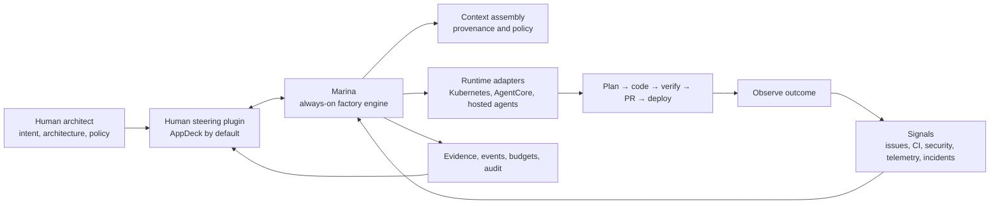

# The Marina Vision

## From coding agent to autonomous software factory

Marina's goal is not to help a developer type code faster. Its goal is to make the software delivery system itself capable of doing useful, governed work continuously—even when no developer has a terminal open, a laptop online, or a hand on the keyboard.

Today's coding agents compress one part of engineering: a human starts an agent, supplies a task, watches it edit a workspace, and eventually pushes a change to Git. That is valuable, but it optimizes only a narrow section of the software delivery lifecycle. The human still has to notice the work, frame it, start the process, preserve context, interpret failures, coordinate review, react to CI, merge, deploy, observe production, and begin the next correction loop.

Marina is the baseline for a future platform-agnostic, always-on software engineering system in which durable autonomous agents can take responsibility for bounded outcomes across the SDLC and DevOps lifecycle. Agents plan, implement, test, review, revise pull requests, respond to delivery feedback, observe production signals, propose or perform remediation, and leave behind evidence. Humans move from continuously operating the tools to defining intent, shaping architecture, setting policy, and steering the system where judgment matters most.

The north star is a **dark software factory**: a software delivery system that can continue safe, useful work without a human present on the factory floor. Here, *dark* means **unattended**, never opaque, unaccountable, or uncontrolled.

This product starts from scratch around that north star. Its creator previously built `platform-marina`, an AWS-native AI agent platform around Bedrock and AgentCore, and brings the technical experience from that work. But Marina is a new concept—not a successor, port, rewrite, migration, or cloud-neutral version of the earlier system. Its architecture and product boundaries must be derived from the dark-factory problem itself.

## The problem

A local coding agent is still coupled to a human session:

- A person must recognize and describe the next task.
- The relevant context is often assembled manually and disappears between sessions.
- The agent's lifecycle is tied to a terminal, workstation, or conversation.
- CI failures, review comments, merge conflicts, deployments, alerts, and production regressions live outside the loop.
- Completion is commonly an agent's claim rather than a state backed by current evidence.
- The workflow stops when the laptop sleeps, credentials expire, context is lost, or the human goes offline.

Optimizing keystrokes or pull-request creation is not the same as optimizing software delivery. The useful unit is not code produced; it is a verified outcome delivered and operated with an acceptable level of risk, cost, and human attention.

## The thesis

The next increase in engineering leverage will not come only from better models. It will come from engineering the system around them:

| Layer | What it engineers | Primary question |
| --- | --- | --- |
| Prompt | One model interaction | What should the model do now? |
| Context | The model's working information | What is the smallest, highest-signal set of facts and constraints it needs? |
| Harness | One bounded agent run | Which tools, workspace, permissions, checkpoints, and exit conditions make the run reliable? |
| Loop | Work across runs and feedback cycles | What triggers the next action, verifies it, persists state, and decides whether to retry, stop, or escalate? |
| Factory | A portfolio of governed loops | How can many outcomes flow safely from intent through production and back again? |

A capable model is a component. An agent adds a decision-and-tool loop. A harness makes that loop operable. Context makes it situated. Loop engineering makes work persistent and repeatable. The factory coordinates many such loops as one observable production system.

Marina is primarily about the last three layers and the contracts between all five.

## The target operating model

The human is not removed from software engineering. The human changes altitude.

The human acts as architect and governor:

- Defines outcomes, priorities, constraints, and acceptance criteria.
- Establishes architecture, engineering principles, and risk policy.
- Chooses where autonomous authority begins and ends.
- Reviews decisions with high ambiguity, novelty, blast radius, or irreversibility.
- Steers the system using evidence from delivery and production.
- Improves the factory when recurring failures reveal a missing capability, constraint, tool, or feedback signal.

The factory performs bounded execution:

- Discovers or receives work.
- Builds a versioned context package.
- Plans and classifies risk.
- Selects an agent runtime and isolated execution environment.
- Implements, tests, reviews, and revises.
- Opens and maintains pull requests.
- Passes through delivery and deployment gates.
- Observes the outcome and reacts within policy.
- Persists state, evidence, cost, decisions, and learning for the next loop.

The first user is the project's creator: one human architect operating personal repositories and steering many agent runs. This single-operator focus is a deliberate product boundary, not an excuse to weaken isolation, authentication, or auditability. Marina should avoid early multi-tenancy, organization administration, team RBAC, and billing complexity while keeping its contracts evolvable for additional users later.

## A real autonomous agent

An independent agent should not be defined as a subprocess spawned inside one terminal conversation. It should be a durable logical actor with:

- A stable identity and declared capabilities.
- Explicit authority and short-lived credentials.
- A goal or claimed task with a renewable lease.
- Durable checkpoints outside the model context window.
- A versioned context package with provenance.
- An isolated, reproducible workspace.
- Time, attempt, token, cost, and concurrency budgets.
- Heartbeats, events, artifacts, and evidence.
- Defined wake-up, pause, resume, cancellation, and escalation behavior.

The agent process itself does not need to run forever. Persistent identity and state should be separated from ephemeral compute. An agent can wake when a webhook, schedule, task, review comment, failed check, alert, or policy event requires work; run in an isolated environment; checkpoint; terminate; and later resume on different infrastructure. The **factory is always on even when individual agents are not**.

This is the key to laptop-off operation. Moving a terminal agent into a long-running container is insufficient. The platform also needs durable scheduling, state, identity, secrets, sandboxing, artifact storage, source-control integration, delivery integration, observability, notification, policy, and recovery after infrastructure failure.

## The autonomous software delivery loop

Marina should eventually close the loop across the whole lifecycle:

1. **Sense** — Receive explicit intent and signals from issues, dependencies, CI, code review, security systems, deployments, support, incidents, logs, metrics, and traces.
2. **Frame** — Convert a signal into a structured outcome with acceptance criteria, constraints, ownership, priority, and budget. Untrusted external content is data, not instruction.
3. **Assemble context** — Select current code, architecture, policy, operational state, history, and tools; record the source and version of each input.
4. **Plan and classify** — Propose a plan, dependencies, verification strategy, rollback path, and risk class. Ask for a human decision only when policy or ambiguity requires it.
5. **Execute** — Claim the work and create an isolated workspace. Use the selected harness and runtime to implement the smallest coherent change.
6. **Verify** — Run deterministic tests and policy checks, then independent agent review where judgment is useful. A producing agent cannot approve its own evidence.
7. **Deliver** — Create or revise a pull request, respond to review and CI, resolve conflicts, and merge only when the applicable evidence gates are satisfied.
8. **Release** — Use the existing delivery system for preview, canary, progressive rollout, rollback, and production promotion according to risk policy.
9. **Observe** — Compare actual behavior with the intended outcome, SLOs, acceptance signals, and guardrails over an explicit observation window.
10. **Respond and learn** — Roll back, remediate, retry, replan, or escalate. Promote only validated lessons into durable guidance; do not turn raw logs or one failed run into trusted memory.

The loop is not "keep prompting until the agent says done." It is a state machine whose transitions require admissible evidence and whose retry paths have budgets and stop conditions.

## Context is factory infrastructure

Long-running autonomy will fail if context is treated as a large prompt assembled once. Marina should treat context as a versioned, queryable supply chain.

The system should distinguish:

- **Intent and policy** — desired outcomes, non-negotiable constraints, risk rules, and architecture decisions.
- **Repository truth** — code, tests, schemas, documentation, build commands, ownership, and executable conventions.
- **Operational truth** — deployed versions, configuration, SLOs, alerts, logs, metrics, traces, incidents, and feature state.
- **Execution state** — task, plan, checkpoints, decisions, tool results, artifacts, and outstanding questions.
- **Experience** — prior outcomes and human feedback, retained with source, confidence, scope, and expiry.

Context assembly should be progressive: begin with a small stable map, retrieve detail when needed, compact stale interaction history, and preserve decisions and unresolved state outside the context window. Every context package should be reproducible enough to answer: *what did this agent know, from which sources, at which versions, when it acted?*

Production data, issue text, pull-request comments, retrieved documents, and tool output may contain prompt injection or incorrect conclusions. Context therefore needs trust labels and provenance, not just relevance scores.

## Harnesses are replaceable execution engines

Marina should not attempt to build a better foundation model or force every agent into one internal reasoning framework. It should define a stable runtime contract around replaceable harnesses.

A runtime adapter should be able to:

- Start, resume, pause, cancel, and time out a run.
- Materialize a pinned repository workspace and context package.
- Expose an allowlisted tool and network surface.
- Issue scoped credentials tied to agent identity and task authority.
- Stream normalized events and heartbeats.
- Checkpoint state and return artifacts, diffs, usage, and verification evidence.
- Report failure in a way another run or another harness can continue.

Codex, Claude Code, a custom agent, an AgentCore harness, or a future runtime should be selectable behind that contract. Portability belongs at the protocol and evidence boundaries; Marina should not standardize the private cognition of each agent.

## AppDeck and Marina

The two product modules should have distinct responsibilities.

**AppDeck is Marina's default pluggable human-steering component.** It provides the visual work surface, backlog, decisions, live state, artifacts, budgets, and completion evidence that tell a human what is happening, why, what is blocked, and where intervention is required.

**Marina is the always-on factory engine and integration host.** It discovers work, reconciles desired outcomes with current state, assembles context, selects runtimes, drives SDLC loops, applies policy, and publishes normalized state and evidence through a stable work-control interface.

AppDeck implements that interface as the first and preferred plugin, but Marina must not require AppDeck to execute headlessly. A future CLI, Git provider, external control plane, or alternative UI should be able to implement the same port. The integration may be in-process or service-to-service; the protocol matters more than the packaging.

Marina should not duplicate AppDeck's product model, and AppDeck should not become a general agent runtime. Each project must configure one authoritative work-control provider to prevent split-brain state. When AppDeck is installed, it owns the human-facing task, decision, and evidence ledger; Marina owns internal workflow checkpoints and reconciles them with AppDeck after restarts and partial failures.

For laptop-off operation, the chosen work-control plugin cannot exist only as a process on the developer's machine. AppDeck should retain its local-first development mode while also supporting a durable, always-on deployment as a Marina component.

## Starting from scratch, informed by experience

Before starting Marina, its creator built `platform-marina`, an AWS-native AI agent platform using Amazon Bedrock, AgentCore, Step Functions, Lambda, DynamoDB, S3, and CloudWatch. That work created practical experience with orchestration, sandboxing, identity, policy, quality gates, context and memory, GitHub delivery, observability, traceability, and cost attribution.

That experience belongs to the human architect, not to Marina's inherited design. Marina does not automatically inherit the earlier repository's code, architecture, six-layer model, backlog, requirements, cloud services, agent framework, or design decisions. It begins with a different concept: an autonomous dark software factory built from first principles on Kubernetes.

The earlier work makes important problem areas visible:

1. Agent orchestration.
2. Secure sandbox.
3. Governance and compliance.
4. Quality gates.
5. Knowledge and context.
6. Observability and analytics.

These are experience-backed questions to reconsider, not a mandatory layer model. Every concept and component must earn its place against Marina's new goals. AgentCore, for example, may later prove useful as a runtime adapter—or may not be part of Marina at all.

The governing principle is: **carry forward understanding, not assumptions**. Prior knowledge should improve the questions, trade-offs, and technical judgment applied to Marina without predetermining the answers.

## Kubernetes: first substrate, not the product

Kubernetes is a strong first platform for Marina because its native model is already a set of durable reconciliation loops: observe current state, compare it with desired state, act, and report status. It provides scheduling, isolation primitives, declarative configuration, secrets integration, workload identity options, resource limits, health checks, restart behavior, and an ecosystem of policy and observability tools. It can run while every developer laptop is off.

However, Kubernetes alone is not an autonomous software factory. It does not define intent, agent identity, task leases, context provenance, verification evidence, pull-request semantics, deployment risk, or when a production signal is safe to act upon.

Marina should therefore be **Kubernetes-first but not Kubernetes-shaped**:

- Use Kubernetes Jobs or equivalent ephemeral workloads for isolated agent runs.
- Run the durable factory services on Kubernetes where appropriate.
- Keep the public task, run, event, artifact, evidence, and runtime contracts independent of Kubernetes resource details.
- Begin with ordinary services and jobs; introduce custom resources and operators only when reconciliation requirements are proven.
- Maintain a local container/process adapter for development.
- Allow managed runtimes such as AgentCore to execute work without pretending they are Kubernetes pods.

This preserves a credible first deployment while avoiding a lowest-common-denominator abstraction or a permanent dependency on one substrate.

## Autonomy is a policy, not a switch

The factory should increase autonomy by risk class and accumulated evidence, not by declaring itself fully autonomous.

| Risk class | Example | Default authority |
| --- | --- | --- |
| Observe | Triage an alert, analyze logs, summarize a failing check | Run autonomously; no mutation |
| Propose | Documentation, tests, dependency update, small code fix | Create branch and pull request autonomously |
| Integrate | Merge a well-bounded low-risk change | Allowed only with independent evidence and explicit repository policy |
| Release | Deploy to preview or non-production | Automated behind delivery gates and rollback capability |
| Operate | Canary, production rollback, tightly bounded remediation | Explicit service policy, blast-radius limits, live health evidence, and escalation |
| Irreversible | Data deletion, broad migration, security-boundary or high-blast-radius change | Human approval required |

The exact thresholds are configurable, but the platform must always know which identity authorized an action, which policy permitted it, which evidence supported it, and how to stop or reverse it.

The initial authority boundary does not need to be decided permanently now. Marina should make it an explicit, versioned policy. The conservative first default is to stop at a merge-ready pull request; evidence from real runs can then justify expanding selected repositories or change classes to merge, release, or bounded operational authority without redesigning the platform.

### Factory invariants

- No lifecycle transition based only on an agent's assertion.
- No action without identity, scope, and an audit event.
- No unbounded loop: every run has time, attempts, spend, and escalation limits.
- No producer is its sole reviewer for a consequential change.
- No raw external signal becomes an instruction or durable memory without validation.
- No silent production mutation; delivery state and rollback path remain observable.
- No learning without provenance, confidence, scope, and a way to revoke it.
- No autonomy level that cannot be paused or reduced by a human.

## Challenge to the vision

The strongest version of this idea must resist several attractive mistakes.

### A software system is not an assembly line

Manufacturing has repeatable inputs and physical tolerances. Software work often begins with ambiguous intent and changes the environment that evaluates it. The factory metaphor is useful for continuous operation and process control, but dangerous if it implies that all engineering judgment can be standardized. Marina should automate execution and feedback without pretending ambiguity has disappeared.

### More agents do not imply more autonomy

Giving every traditional job title to a separate agent can create coordination cost, duplicated context, correlated errors, and the appearance of review without independent evidence. Start with the fewest loops and roles needed. Add specialization only where different context, tools, permissions, or independent evaluation materially improve the outcome.

### Production feedback is not self-explanatory

An alert can be noisy, a metric can be gamed, a customer report can be wrong, and logs can contain hostile input. A closed loop can amplify a bad diagnosis faster than a human-operated process. Production-driven remediation must use correlation, confidence, risk classification, observation windows, canaries, rollbacks, and explicit stop conditions.

### Platform agnosticism has a cost

Clouds and agent runtimes differ in identity, isolation, networking, storage, lifecycle, and observability. Abstracting everything immediately will produce a weak lowest-common-denominator platform. Marina should first standardize the contracts that matter—work, context, runtime control, events, evidence, and policy—then prove a Kubernetes implementation and one alternate adapter such as AgentCore.

### Kubernetes can become premature infrastructure

A cluster adds operational burden before the factory semantics are proven. The first milestone should demonstrate durable remote execution with restart recovery and evidence; it should not require a custom operator. Kubernetes earns deeper architectural importance only as scheduling, isolation, reconciliation, or multi-tenancy demands it.

### Faster output can create faster entropy

Pull-request count, commits, and lines of code are dangerous success metrics. Agents can multiply inconsistency, dependencies, stale documentation, and operational load. The factory must also perform deletion, simplification, documentation gardening, dependency hygiene, architecture conformance, and other forms of entropy control.

### Human attention can remain the bottleneck

If every plan, diff, retry, and deployment waits for review, the laptop is no longer the bottleneck but the human inbox is. Approval boundaries must be risk-based, decisions must be concise and evidence-rich, and repeated approvals should be converted into enforceable policy where safe.

## Measures of success

Marina should optimize verified outcomes and scarce human attention, not code volume.

Useful measures include:

- Lead time from accepted intent or detected defect to verified outcome.
- Human attention minutes per successfully delivered change.
- Percentage of tasks completed without synchronous human intervention.
- Percentage of escalations that were necessary and actionable.
- First-pass and eventual evidence-gate pass rates.
- Change failure rate, rollback rate, escaped defects, and mean time to recovery.
- Time from production signal to diagnosis, safe remediation, and confirmed recovery.
- Cost per verified outcome, including model, compute, retries, and review.
- Context freshness and provenance coverage.
- Rate of architectural, security, and documentation entropy.

Autonomy is successful only when it improves these measures without hiding risk or moving toil into a different queue.

## The first proof

The baseline should prove one complete laptop-off loop before attempting a general platform:

1. A human defines a bounded task and acceptance criteria through the installed AppDeck plugin, then disconnects.
2. Always-on Marina claims the task with a lease and persists a plan.
3. Marina starts an isolated Kubernetes job through a runtime adapter.
4. The agent checks out a pinned revision, receives a versioned context package, and implements the change.
5. Deterministic checks and an independent reviewer produce evidence.
6. The agent opens a pull request and responds to CI or review feedback through bounded revision loops.
7. The AppDeck plugin shows truthful state, decisions, cost, artifacts, and evidence after either component restarts.
8. The run stops at the configured authority boundary—initially a merge-ready pull request—and requests a focused human decision only if required.

The next proof closes a small operational loop: a controlled production-like signal creates a diagnostic task, an agent reproduces the issue, proposes a tested remediation, delivery deploys it to a canary environment, and Marina verifies recovery or rolls back. Direct autonomous production mutation is not required to prove the architecture.

## Evolution path

1. **Durable remote worker** — One runtime adapter, isolated workspaces, restart recovery, budgets, normalized events, a work-control plugin interface, and the AppDeck plugin.
2. **Unattended pull-request loop** — Plan, implement, test, independent review, PR creation, CI/review revision, and evidence-gated completion.
3. **Delivery loop** — Preview and non-production deployment, progressive delivery integration, observation windows, and automatic rollback.
4. **Production feedback loop** — Alert and telemetry intake, diagnosis, remediation proposals, bounded operational actions, and verified recovery.
5. **Portable factory** — Additional harness and provider adapters, multi-project policy, stronger tenancy, capacity management, and evidence-driven autonomy tuning.

## Non-goals

Marina is not intended to:

- Eliminate human accountability for software and production systems.
- Replace source control, CI, CD, incident management, or observability products.
- Let agents bypass repository protection or delivery controls.
- Treat every task as suitable for autonomous execution.
- Equate an LLM review with deterministic correctness.
- Require long-lived agent processes when durable state and ephemeral execution are safer.
- Require AppDeck for headless execution or hard-code its storage model into Marina.
- Hide one vendor-specific implementation behind superficial "platform-agnostic" language.
- Optimize for the maximum number of agents, tokens, commits, or pull requests.

## Decisions and current defaults

Two product directions are now explicit:

- Marina is initially a single-operator product for its creator's own repositories.
- AppDeck is the default pluggable human-steering component, not a mandatory dependency of the factory core.

The remaining product decisions should stay explicit rather than becoming accidental implementation choices:

1. How and where will the first always-on installation run?
2. Which first runtime proves portability after a generic Kubernetes-hosted harness: Bedrock AgentCore, a hosted Codex-style runtime, or another container harness?
3. Which production feedback source should close the first real loop: CI/review feedback, deployment health, an alerting system, error tracking, or support/customer feedback?
4. Which actions must always remain human decisions regardless of confidence or accumulated evidence?
5. What evidence and operating history must exist before a repository advances beyond merge-ready-PR authority?

Until these are decided, the recommended baseline is single-operator, self-hosted in an always-on environment, Kubernetes-first, merge-ready-PR autonomy as a reversible policy default, AppDeck as the first work-control plugin, and no assumed alternate runtime until the core contract has been proven.

## Influences

- [Harness engineering: leveraging Codex in an agent-first world](https://openai.com/index/harness-engineering/) — environments, agent legibility, repository knowledge, feedback loops, and human attention as the scarce resource.
- [Unrolling the Codex agent loop](https://openai.com/index/unrolling-the-codex-agent-loop/) — the boundary between a model, the agent loop, tools, context, and a harness.
- [Effective context engineering for AI agents](https://www.anthropic.com/engineering/effective-context-engineering-for-ai-agents) — high-signal context, compaction, persistent notes, and context isolation.
- [Kubernetes controllers](https://kubernetes.io/docs/concepts/architecture/controller/) — desired-state reconciliation as a durable control-loop model.
- [AgentCore harness vs. Runtime](https://docs.aws.amazon.com/bedrock-agentcore/latest/devguide/harness-vs-runtime.html) — a useful separation between managed execution infrastructure and the agent loop itself.

## The destination

Marina succeeds when software engineering no longer begins with "open the laptop and start the agent."

A human should be able to express intent, define boundaries, and step away. The factory should continue to discover, execute, verify, deliver, observe, and improve within those boundaries. When the human returns, AppDeck should show not activity theater but an evidence-backed account of what changed, why it changed, what the agents learned, what the system could not decide, and where human judgment has the highest leverage.

That is the shift from faster code writing to an autonomous software delivery system—from a coding assistant to an inspectable dark software factory.
